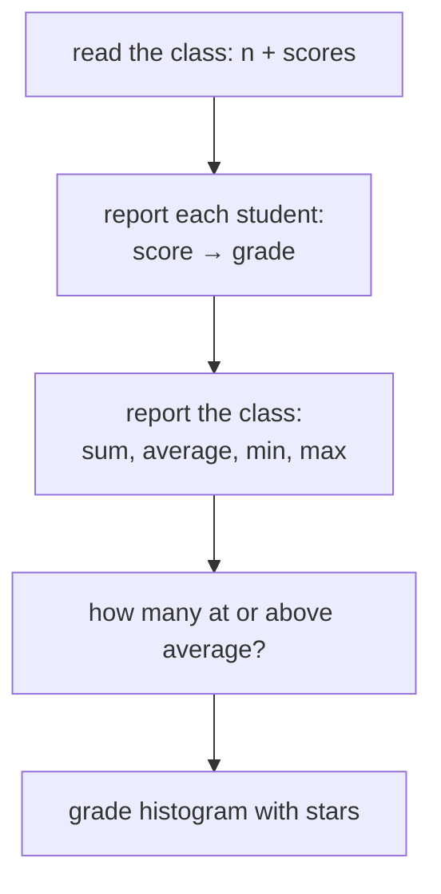

# Final Task — The Class Report Card

> **What this is:** the closing task of the whole C workshop. It needs
> **nothing new** — every single piece is something you already solved in a
> previous problem. Your job is not to learn something new. Your job is to
> **assemble**: reuse your own functions, glue them with `main`, and feel
> the payoff of one rule:
>
> # Write once. Use everywhere.
>
> **Concepts combined:** variables · `printf`/`scanf` · `if/else` ·
> validation loops · arrays · functions (typed, void, array parameters) ·
> composing functions that call functions

---

> **Note:** if you did not understand anything in this task, just paste it
> into ChatGPT or your AI tool and ask it to explain — and you will learn.

---

## 1. The Story

You are the registrar of a small class. Every student wrote one exam. Build
a program that produces a **report card** for the whole class — the kind a
teacher would love to receive.



## 2. The Requirements

1. Ask **how many students** (`n`, validate `1 … 1000` — the global
   `MAX_SIZE = 1000` from your solutions is the limit).
2. Read each student's **score** (`0 … 100` — reject, re-ask, repeat).
3. Print **each student's grade** (A–F rules below).
4. Print the class **average** (2 decimals), **highest** and **lowest**
   scores.
5. Count how many students scored **at or above** the average.
6. Print a tiny **grade histogram**: for each grade A–F, one row of `*`
   — one star per student with that grade.
7. Quit gracefully if `n` or the scores are invalid input.

### Grading rules

| Score | Grade |
|---|---|
| 90 – 100 | `A` |
| 80 – 89 | `B` |
| 70 – 79 | `C` |
| 60 – 69 | `D` |
| 0 – 59 | `F` |

---

## 3. Your Inventory — You Already Own Every Part

Do not re-solve anything. **Open your previous solutions and paste the
functions in.** This table is the map:

| Report card feature | You solved it in | Function you will paste |
|---|---|---|
| Reading `n` numbers into an array | S3 P01 | (in `main` — reuse the loop shape) |
| Score validation loop | S2 (guessing-game style) + S4 P04 | `main`'s reading loop |
| sum of an array | S4 P03 | `int sum(int arr[], int n)` |
| average of an array | S4 P03 | `float average(int arr[], int n)` |
| min / max of an array | S4 P03 | `minValue` / `maxValue` |
| grade letter from a score | S4 P04 | `char gradeOf(int score)` |
| print every student + grade | S4 P04 | `void printScoresAndGrades(...)` |
| count at/above a threshold | S4 P04 | `int countAtOrAbove(...)` |
| histogram per grade | S4 P04 (Try It Yourself!) | new, but 10 lines — `gradeOf` + counters |

One thing might be genuinely new: the histogram. But look at its pieces —
a counter per grade and a `*`-printing loop. You have built both shapes
repeatedly (S3 P03 counters, S2 multiplication-table loops).

> **The lesson of this task is the table above.** This is what professional
> programming is: not solving new problems in new code, but *recognizing*
> that today's problem is yesterday's problems, wired together.

---

## 4. Example Run (your target output)

```
How many students? 4
Enter score for student 1 (0-100): 95
Enter score for student 2 (0-100): 72
Enter score for student 3 (0-100): 88
Enter score for student 4 (0-100): 45

--- Individual Report ---
Student 1: 95 → A
Student 2: 72 → C
Student 3: 88 → B
Student 4: 45 → F

--- Class Report ---
Class size : 4
Sum        : 300
Average    : 75.00
Highest    : 95
Lowest     : 45
At or above average: 2 student(s)

--- Grade Histogram ---
A: *
B: *
C: *
D:
F: *
```

(`D` row is empty this time — that must not crash your program: a grade
that no one earned simply prints zero stars.)

---

## 5. Suggested Order of Work

Build it the **function way**: smallest machines first, compose upward.

1. **Step 1:** paste `sum`, `average`, `minValue`, `maxValue` from
   S4 P03. They are perfect already — do not "improve" them, just *reuse*.
2. **Step 2:** paste `gradeOf` and `printScoresAndGrades` from S4 P04.
3. **Step 3:** paste `countAtOrAbove` from S4 P04.
4. **Step 4:** write `main` as a **manager only**: read data (with the
   validating loop), then call the machines, then print section headers
   between them.
5. **Step 5 (last, hardest):** the histogram function:

```c
void printHistogram(int scores[], int n)
{
    int counts[5] = {0};               /* A,B,C,D,F → indexes 0..4 */

    for (int i = 0; i < n; i++) {      /* tally each student once  */
        char g = gradeOf(scores[i]);   /* reuse the ONE grade brain */
        if (g == 'A') counts[0]++;
        else if (g == 'B') counts[1]++;
        else if (g == 'C') counts[2]++;
        else if (g == 'D') counts[3]++;
        else counts[4]++;
    }

    /* print five rows */
    printf("\n--- Grade Histogram ---\n");
    char grades[5] = {'A', 'B', 'C', 'D', 'F'};
    for (int i = 0; i < 5; i++) {
        printf("%c: ", grades[i]);
        for (int j = 0; j < counts[i]; j++) {
            printf("*");
        }
        printf("\n");
    }
}
```

Notice what this new function is made of: **nothing new** — a counter,
`tally` loop using `gradeOf`, and a nested star loop from Session 2. It is
a composition, like everything else.

6. **Step 6:** test it like a villain:

```
- 1 student                     (edge)
- 100 students                  (edge)
- 1000 students                 (edge — exactly the global MAX_SIZE)
- n = 0 or n = 500              (must be rejected)
- score = -5, 101, "abc"        (must be rejected and re-asked)
- a grade no one earned         (empty histogram row — must not crash)
- all same score                (check "at or above" counts everyone)
```

---

## 6. Level-Up Extensions (optional)

1. **Student names?** Open `learning/strings-in-c.md` and try Section 9
   exercise 1 first — then try storing one `char names[100][50]` table.
   (Or just leave it — strings are *next level* of the course.)
2. **Sorting:** print the class from highest to lowest score without
   destroying the original order of `scores` (mirror-copy trick of S3 P05
   applied to an index ordering is a classic — try the copy-then-select
   the max approach).
3. **Save to a text file:** `FILE *f = fopen("report.txt", "w");` — peek
   ahead: this is a taste of the next stage of your C journey.
4. Refactor `main` so that **no printf of data happens inside main** —
   every section of output is delivered by a `void` function
   (`printIndividualReport`, `printClassReport`, `printHistogram`). Your
   `main` should read like a table of contents.

---

## 7. Grading Yourself (honest rubric)

| Check | P |
|---|---|
| Compiles with `gcc solution.c && ./a.out` | [ ] |
| Rejects invalid `n` **and** invalid scores without crashing | [ ] |
| Grades every student with exactly one `gradeOf` definition | [ ] |
| Uses pasted functions from S4 P03/P04 **without rewriting their logic** | [ ] |
| Zero-count histogram row does not crash | [ ] |
| `main` is mostly calls and reads — a "manager", not a factory | [ ] |

10/10 means: you did not RE-solve any solved problem — you re-**used**
it. That is the entire mentality of this workshop, and of programming:

# Write once. Use everywhere.

---

> **Note (one more time):** stuck? Paste the step you are stuck on into
> ChatGPT or your AI tool, ask it to explain — and you will learn. Then
> come back and finish it yourself.
