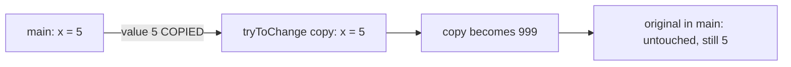
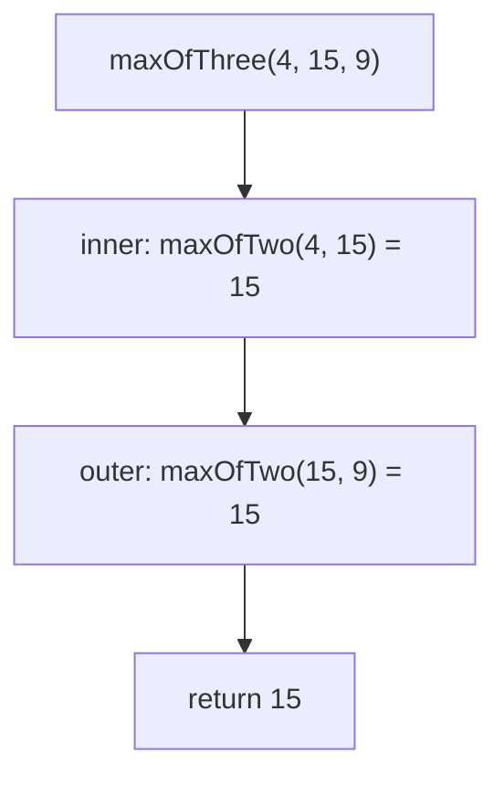

# Functions in C — Explained Simply, With Examples

> **Why this document exists:** functions are the single most important
> idea in programming. This page explains them **as simply as possible**,
> with short examples you can run. If a session was too fast, start here.
>
> **Prerequisite:** Sessions 1–2 (variables, if/else, loops). That is all
> you need.

---

> **Note:** if you did not understand anything in this document, just paste
> it into ChatGPT or your AI tool and ask it to explain — and you will
> learn.

---

## 1. The Idea in One Sentence

> A function is a **machine**: you put something in, it does its one job,
> and (usually) something comes out.

```c
#include <stdio.h>

int square(int x)          /* machine named "square"   */
{                          /* x is the input slot      */
    return x * x;          /* the output               */
}

int main()
{
    printf("%d\n", square(7));   /* feed 7 in → get 49 out */
    return 0;
}
```

Prints: `49`

Why bother? Three reasons:

1. **Write once, use everywhere** — write the code once, call it a million
   times.
2. **Split a big problem into small pieces** — a 500-line `main` is a
   nightmare; 10 small functions are readable.
3. **Bug fixing in one place** — if `square` is wrong, you fix it once and
   every caller is fixed.

---

## 2. The Anatomy of a Function

```c
int doubleOf(int n)
{
    return n * 2;
}
 └─┬─┘ └──┬───┘ └┬┘
 type  name   param(s)
```

| Part | What it is | Rule |
|---|---|---|
| `int` (return type) | the type of the thing it **gives back** | any type: `int`, `float`, `char`, or `void` |
| `doubleOf` (name) | what you call later | name it after its **job** |
| `(int n)` (parameter) | the input slot — a variable that exists only inside | several allowed: `(int a, int b)` |
| `return n * 2;` | the output | sends the value back and **ends** the function immediately |

And the caller side:

```c
int twice = doubleOf(21);   /* 21 is the ARGUMENT: what you feed in */
```

Parameters (the slots) and arguments (the fed values) pair up **in order,
left to right**: first argument → first parameter, second → second.

---

## 3. void Functions: Machines That Make Noise

Some machines don't produce anything — they *do work* (usually printing)
and give back nothing. Their return type is `void`:

```c
#include <stdio.h>

void printLine(int n)          /* void = no output value */
{
    for (int i = 0; i < n; i++) {
        printf("----\n");
    }
}

int main()
{
    printLine(3);   /* call it — you get 3 lines, not a value */
    return 0;
}
```

**How to choose?** Ask: *"do I need the answer back?"*

- Yes (a sum, a max, a grade letter…) → **typed** function
- No (printing a banner, a menu that reads input, a report) → **void**

| | typed (`int`, `float`, `char`…) | `void` |
|---|---|---|
| Returns a value? | yes — `return x;` | no |
| Usable in expressions? | yes — `if (maxOfTwo(a,b) > 10)` | no — call it as a statement |
| Return statement | required on every path | optional (ends early only) |

Run this and see the difference live:

```c
#include <stdio.h>

int getNumber()                 /* typed: gives back a value  */
{
    int x;
    printf("Enter a number: ");
    scanf("%d", &x);
    return x;
}

void sayHello()                 /* void: does its thing, exits */
{
    printf("Hello!\n");
}

int main()
{
    sayHello();                       /* statement: just call it  */
    int n = getNumber();              /* store what it returns    */
    printf("You typed %d\n", n);
    printf("Twice that is %d\n", getNumber() * 2);   /* use it inline! */
    return 0;
}
```

---

## 4. Pass by Value: Functions Get COPIES

This is the muscle memory for the entire course, so test it yourself:

```c
#include <stdio.h>

void tryToChange(int x)
{
    x = 999;              /* changes the COPY, not the original */
    printf("Inside:  x = %d\n", x);
}

int main()
{
    int x = 5;
    tryToChange(x);
    printf("Main:     x = %d\n", x);    /* still 5! */
    return 0;
}
```

Prints:

```
Inside:  x = 999
Main:     x = 5
```

What happened:



Rule of thumb: **a function can read what you hand it, but cannot reach
into your variables.** It works on photocopies. (How functions *do* change
caller variables is the pass-by-reference story — later, in course
material. For now: functions return their answers with `return`; they do
not edit your variables.)

Want three values out of a machine? Return one and compute the others in
the caller, or use several functions — all patterns you have already
practiced.

---

## 5. Functions Calling Functions (the LEGO step)

Small machines compose into big machines:

```c
#include <stdio.h>

int maxOfTwo(int a, int b)
{
    if (a > b) return a;
    return b;
}

int maxOfThree(int a, int b, int c)
{
    return maxOfTwo(maxOfTwo(a, b), c);   /* reuse — no new logic! */
}

int main()
{
    printf("%d\n", maxOfThree(4, 15, 9));   /* 15 */
    return 0;
}
```

Trace `maxOfThree(4, 15, 9)`:



**Never duplicate logic.** If you catch yourself pasting the same `if`
into a second function — stop. Call the first function instead. A bug
fixed in `maxOfTwo` is then fixed *everywhere automatically*. Duplicated
code is where bugs hide.

---

## 6. Parameters Can Be Lots of Things (including arrays)

A function that eats a number:

```c
int absolute(int x) {
    if (x < 0) return -x;
    return x;
}
```

A function that eats **an array** — the array rides in with its length:

```c
#include <stdio.h>

int sum(int arr[], int n)      /* "int arr[]" = an int array arrives */
{
    int total = 0;
    for (int i = 0; i < n; i++) {
        total += arr[i];
    }
    return total;
}

int main()
{
    int numbers[4] = {10, 20, 30, 40};
    printf("%d\n", sum(numbers, 4));   /* array by name + its length */
    return 0;
}
```

Prints: `100`

Note two things:

1. In the **call**, passing an array needs **no `&`, no `[]`** — just the
   name: `sum(numbers, 4)` (the length as a second argument — that is why
   `n` travels with it).
2. Inside the function, `arr[i]` works exactly like `numbers[i]` did in
   `main`. Nothing new — same loops, same logic.

> Curious detail (do not stress): number parameters arrive as copies, but
> an **array** parameter is *not* copied — the function sees the same
> boxes. That is C being efficient, and the reason `n` is passed
> separately. Take the pattern, move on; you will meet the deeper why when
> the course covers it.

---

## 7. Local vs Global Variables (where variables live)

Every variable has a **home**:

```c
#include <stdio.h>

int MAX_SIZE = 1000;    /* GLOBAL: outside every function            */
                        /* every function sees it, alive all run     */

void printLimit()
{
    int localLimit = 5; /* LOCAL: dies when this function ends       */
    printf("Limit %d of %d\n", localLimit, MAX_SIZE);
}

int main()
{
    printLimit();
    printf("MAX_SIZE from main = %d\n", MAX_SIZE);  /* works!        */
    /* printf("%d", localLimit); ← ERROR: not visible in main       */
    return 0;
}
```

| | Global (like `MAX_SIZE`) | Local (like `localLimit`, `n`) |
|---|---|---|
| Declared | top of file, outside all functions | inside a function |
| Visible to | **every** function | only its own function |
| Lifetime | whole program run | created on call, destroyed on return |
| Use when | a shared constant (max sizes) shared by many functions | 99% of the time — always prefer local! |

Golden rule: **stay local by default.** Globals are for things that
genuinely belong to the whole file (a shared max size is exactly that).
Why shy from over-using globals? Because any function can change them
silently — a local cannot be corrupted from far away.

---

## 8. The Full Picture: A Tiny Program Built From Functions

This is the instructor's user-sized-array pattern (Session 3, Problem 03
onward) in a function-shaped program:

```c
#include <stdio.h>

int MAX_SIZE = 1000;                  /* global: the safety ceiling     */

int sum(int arr[], int n)             /* eats an array, returns total   */
{
    int total = 0;
    for (int i = 0; i < n; i++) {
        total += arr[i];
    }
    return total;
}

float average(int arr[], int n)       /* reuses sum -- again!           */
{
    return (float)sum(arr, n) / n;
}

int readSize()                        /* typed: reads + validates size  */
{
    int size;
    do {
        printf("Enter the size of the array (1-%d): ", MAX_SIZE);
        scanf("%d", &size);
    } while (size <= 0 || size > MAX_SIZE);   /* global used by a machine */
    return size;
}

void printReport(float a)             /* void: prints, returns nothing  */
{
    printf("Average = %.2f\n", a);
}

int main()
{
    int size = readSize();

    int numbers[size];                /* sized by the USER, at runtime  */

    for (int i = 0; i < size; i++) {
        printf("Number %d: ", i + 1);
        scanf("%d", &numbers[i]);
    }

    printReport(average(numbers, size)); /* machines compose inline     */
    return 0;
}
```

Look at what `main` became: **read, delegate, print** — a manager, not a
factory. Every line delegates to a named machine. And notice the two
variable names doing one job: the user's choice travels from
`readSize` (as `size`, returned) into `main` (as `size`) and into the
machines (as the parameter `n`). Each function names its own inputs —
the values flow, the names stay local.

---

## 9. Common Beginner Mistakes (checklist)

1. **Calling before declaring.** Define the function *above* `main` (or
   learn prototypes later).
2. **`return` in a void function with a value** — `void` returns nothing
   (`return;` alone is legal, `return x;` is not).
3. **Expecting the function to change your variables** — it cannot (pass
   by value). Get answers only via `return`.
4. **Forgetting the return type** — `square(int x)` without `int` will
   not compile.
5. **Wrong return type for decimals** — an `int` return chops decimals:
   a `int divide(...)` version of `divide(7, 2)` returns `3`, not `3.5`.
6. **Duplicating logic instead of calling the existing function.**
7. **A global of everything** — resist; local by default.

Run each and watch the compiler yell — the compiler is your friend, and
`gcc -Wall -Wextra` is the loud friend.

---

## 10. Mini-Exercises (easy → level-up)

1. **Warmer:** `int doubleOf(int n)` and `int tripleOf(int n)` — test
   them in `main` with a loop over 1..5.
2. **Banner printer:** write `void printBanner()` and
   `void printResult(int x)`, then assemble a tiny report: banner, a
   result, a closer line. All void — pure assembly.
3. **`int minOfThree(int a, int b, int c)`** that reuses a `minOfTwo` you
   write first. (Mirror of Session 4 Problem 02.)
4. **`int sumOfDigits(int n)`** — a machine that eats 4729 and returns
   4+7+2+9. One machine, one loop, one modulo.
5. **Temperature table:** write `float celsiusToFahrenheit(float c)`,
   then a `void printTable(float fromC, float toC)` that loops from
   `fromC` to `toC` in steps of 5 and calls the first machine for every
   row. (A typed machine reused inside a void machine — composition!)
6. **Level-up:** refactor Session 3's Problem 04 (linear search) into
   `int linearSearch(int arr[], int n, int target)` — returning the
   position, or `-1` when absent. (Returning a sentinel — extremely
   common in real libraries.)

---

## 11. Key Takeaways

- A function = **type + name + parameters + body + return**. A machine.
- `void` functions do work; typed functions give answers back.
- Parameters arrive as **copies** (pass by value) — functions never touch
  your variables; they answer with `return`.
- Functions call functions — that is how you build big from small.
- Arrays ride into functions as `type arr[]` **plus** their length `n`.
- **Local by default, global when truly shared** (like `MAX_SIZE`).
- The whole mentality: **write once, use everywhere.**

---

> **Note (again):** if any example felt like alien language, paste it into
> ChatGPT or your AI tool and ask "explain this line by line" — and you
> will learn.
