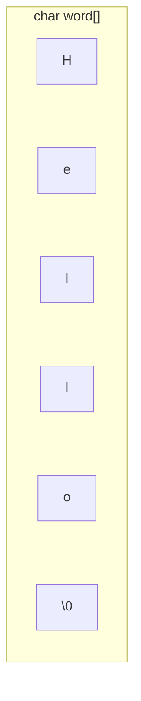

# Strings in C — The Complete Guide

> **Why this document exists:** strings were **not covered** in the
> workshop sessions, but you will meet them in exercises, interviews and
> your own projects. This is your self-study chapter — read it slowly, run
> every code block, and come back to it like a reference book.
>
> **Prerequisite:** Session 3 (arrays). Because here is the secret: a
> string in C **is** an array. Nothing more. You already know 90% of this.

---

> **Note:** if you did not understand anything in this document, just paste
> it into ChatGPT or your AI tool and ask it to explain — and you will
> learn.

---

## 1. The Big Secret: Strings Are Just Arrays

In Python or Java, there is a special "string type". In C there is **no
string type at all**. A string is simply:

> An **array of `char`** that ends with a special character: the **null
> terminator** `'\0'`.

```c
char word[] = "Hello";
```

That line creates **6** boxes, not 5:



Why 6? Because every function that touches your string needs to know
**where it ends** — and instead of carrying the length in a second
variable (like we did with `int n` for number arrays!), C ends every string
with the invisible `'\0'`.

| | Array of ints (Session 3) | String (char array) |
|---|---|---|
| How does the code know the end? | You pass `n` yourself | It finds `'\0'` |
| Declared | `int a[5];` | `char word[] = "Hello";` or `char word[100];` |
| Why 6? The `'\0'` terminator needs its own box — see below. | nothing (you track the length) | one extra box for `'\0'` |

---

## 2. Declaring Strings — All the Ways

```c
char word[] = "Hello";       /* 6 boxes: "Hello\0" — size auto-counted  */
char word[10] = "Hi";        /* 10 boxes; boxes 3..9 are empty for now  */
char buffer[100];            /* 100 empty boxes waiting for input       */
char letters[] = { 'A', 'B', '!' };  /* NO \0: this is NOT a string!    */
```

Contrast trap: `letters` above is just a char array — no `'\0'` means
any function reading it will walk past the end and read garbage memory.
**Prefer the `"..."` form** — it adds the `'\0'` for you automatically. If
you ever build a string by hand (char by char), you must add the
terminator yourself.

**The `+1` rule:** "Hello" has 5 characters, but room for **6** is needed
(`5 + 1` for `'\0'`). If a name may hold 30 letters, declare:

```c
char name[31];
```

---

## 3. Printing and Reading

### Printing with `%s`

```c
char word[] = "Hello";
printf("%s\n", word);     /* prints: Hello              */
printf("%c\n", word[0]);  /* prints: H (ONE character)  */
```

| | `%s` | `%c` |
|---|---|---|
| Prints | the whole string, from box 0 until `'\0'` | exactly one char |
| Needs | the array **name** (no `&`!) | one char value |

### Reading with `scanf("%s")` — fast but dangerous (like driving without a belt)

```c
char name[20];
scanf("%s", name);        /* NOTE: NO & — names of arrays are addresses */
```

Danger zone: if the user types 30 characters, `scanf` happily writes 30 +
1 boxes into your 20-box array — **out of bounds**, corrupting memory
(Session 3's bounds-checking story, part 2).

### The safe way: `fgets`

```c
char name[20];
fgets(name, sizeof(name), stdin);   /* reads at most 19 chars + \0 — SAFE */
```

`fgets` also captures the trailing newline the Enter key adds, and you can
clean it:

```c
size_t len = strlen(name);
if (len > 0 && name[len - 1] == '\n') {
    name[len - 1] = '\0';   /* drop the newline                */
}
```

> Simplification: `sizeof(name)` = the declared box count. The concept of
> `size_t` shown here is just an integer type — treat it as a number for
> now.

---

## 4. Walking a String — Every Loop You Know, Back on Stage

Session 3 taught you: loop over an array `0 … n-1`. With strings, `n` is
**not known** — so the loop tells you where to stop:

```c
char word[] = "Hello";

for (int i = 0; word[i] != '\0'; i++) {   /* stop at the terminator */
    printf("%c ", word[i]);               /* H e l l o              */
}
```

The same, using a `while`:

```c
int len = 0;
while (word[len] != '\0') { len++; }      /* len counts the rooms   */
printf("%d\n", len);                      /* 5                      */
```

This length-counting loop is **so important** that the standard library
gives it a name:

---

## 5. The `<string.h>` Toolbox (like a built-in function library!)

```c
#include <string.h>
```

Session 4 taught you the *concept* of a function library: a set of small
pre-made machines you can call. `<string.h>` is exactly that. The four
you will meet most:

| Function | What it does | Example |
|---|---|---|
| `strlen(s)` | returns the number of characters **before** `'\0'` (the terminator doesn't count) | `strlen("Hello") == 5` |
| `strcpy(dest, src)` | **copies** the string `src` into array `dest` (adds the `'\0'` itself) | `strcpy(copy, name);` |
| `strcmp(a, b)` | compares two strings — see the next section please | `strcmp(word, "exit") == 0` |
| `strcat(dest, src)` | glues `src` to the **end** of `dest` (dest must have room!) | `strcat(full, name);` |

### How strcmp really works

`strcmp("apple", "banana")` walks both strings character by character and
returns an int:

- **0** → the strings are **equal**
- **< 0** → first different char is smaller in `a` (a is "before" b)
- **> 0** → the other way around

```c
if (strcmp(a, b) == 0) {
    printf("Same!\n");
}
```

---

## 6. The Classic Bug: `==` Does NOT Compare Strings

```c
char a[] = "yes";
char b[] = "yes";

if (a == b) {        /* WRONG — compares ADDRESSES, not content!   */
    printf("same");  /* never runs                                 */
}

if (strcmp(a, b) == 0) {   /* RIGHT — compares the content          */
    printf("same");        /* runs!                                 */
}
```

Memory diagram:

```mermaid
flowchart LR
    A["a → box of 'y', 'e', 's', \\0<br/>lives at address 100"]:::v
    B["b → box of 'y', 'e', 's', \\0<br/>lives at address 500"]:::v
    A -- content equal --> B
    A -- addresses DIFFERENT (100 vs 500) -.->|a == b is false| B
    classDef v fill:#dbeafe,stroke:#2563eb
```

Why does a number array comparison work differently? Well… Session 3 never
compared arrays with `==` either — you always compared **elements** inside
a loop (`numbers[i] == target`). A string comparison by `strcmp` is
exactly that: an element-by-element loop someone wrote for you and
packaged into a function. **The function mentality again!**

---

## 7. Combining Everything You Already Know

A string is an array. Arrays played nice with loops; with counters used as
the index of a second array (Session 3, Problem 03); with functions taking
`type arr[]` (Session 4, Problem 03). All of that re-applies:

```c
#include <stdio.h>

int countVowelBoxes(char s[])
{
    int count = 0;
    for (int i = 0; s[i] != '\0'; i++) {
        if (s[i] == 'a' || s[i] == 'e' || s[i] == 'i' ||
            s[i] == 'o' || s[i] == 'u') {
            count++;
        }
    }
    return count;
}

int main()
{
    char sentence[100];
    printf("Type a sentence: ");
    fgets(sentence, sizeof(sentence), stdin);

    printf("Vowel boxes: %d\n", countVowelBoxes(sentence));
    return 0;
}
```

Small classic — "write your own `strlen`", the loop pattern that
`<string.h>` packages for you (write once, use everywhere — even the C
inventors thought so):

```c
int myStrlen(char s[])
{
    int len = 0;
    while (s[len] != '\0') {
        len++;              /* walk to the terminator           */
    }
    return len;             /* how many real rooms, boxes 0..len-1 */
}
```

And a word-reverser — Session 3's backward walk + mirror formula, now on
chars:

```c
void reverseWord(char s[], char out[])
{
    int len = myStrlen(s);          /* the function calls a function!   */
    for (int i = 0; i < len; i++) {
        out[len - 1 - i] = s[i];     /* the same mirror formula         */
    }
    out[len] = '\0';                /* close the new string yourself!  */
}
```

---

## 8. The Pitfall Checklist (read before touching strings!)

1. **Size +1.** "Hello" fits in 6 boxes, not 5.
2. **Watch out when you copy:** `char a[6] = "Hello", b[5]; strcpy(b, a);`
   → `strlen("Hello")` is 5, but the **copy** needs 6 boxes
   (`5 + '\0'`): buffer overflow. Give `dest` at least
   `strlen(src) + 1`.
3. **`==` never compares strings** — use `strcmp(a, b) == 0`.
4. **`scanf("%s")` without a width limit** can write past the array — use
   `fgets`, or at least limit with a field width.
5. **An un-terminated char array is a time bomb**: if you build a string
   char by char, end it with `s[len] = '\0';` yourself.
6. **`strcat` only makes sense if `dest` has enough room** — checking
   first (`strlen(dest) + strlen(src) + 1`) is the professional way.
7. **`fgets` keeps the `'\n'` the Enter key adds** — clean it before
   comparing (Section 3).

---

## 9. Mini-Exercises (easy → level-up)

Practice in order. Each builds on a thing the sessions already taught you.

1. **Warm-up — print a string letter by letter:** read a line with
   `fgets`, print it one character per line (stop at `'\0'`).
2. **Count letters:** how many characters long is your name? Write your
   own loop first, then confirm with `strlen`.
3. **Count vowels AND consonants** — the evens/odds split (Session 3
   Problem 03), char-edition: two counters, one `if/else`.
4. **Echo search:** read a word, then report
   at which position a given letter appears first (Session 3's linear
   search — the sentinel-value `-1` pattern applies beautifully).
5. **Palindrome check** (level-up): does "level" read the same backwards?
   Compare `s[i]` with `s[len - 1 - i]` for every `i` — Session 3's mirror
   formula decides! If any pair differs, it is not a palindrome. No
   swapping, no reversing: pure comparison.
6. **Exit-word loop** (level-up): read lines until the user types "exit".
   `strcmp(line, "exit") == 0` ends the loop — Session 2's menu-loop
   pattern (the calculator menu), now fed with text instead of numbers.

---

## 10. Key Takeaways

- A C string = `char` array + `'\0'` terminator. Always plan the **+1** box.
- `%s` prints a whole string (no `&`); `%c` prints one character.
- Reading: `fgets` > `scanf("%s")`. `fgets` keeps `'\n'` — clean it.
- Loop until `'\0'`; all Session 3 array wisdom transfers directly.
- `<string.h>` gives ready functions: `strlen`, `strcpy`, `strcmp`,
  `strcat`.
- `==` compares **addresses**, never string content — `strcmp(a, b) == 0`
  is the correct check.
- To write a string tool you never relearn anything — you re-**apply**:
  loops, counters-as-index, mirror formulas, sentinel values,
  functions-that-take-arrays. Strings did not add a *new* concept; they
  only changed the type of the box.

---

> **Note (again):** strings have a lot of small traps. If ANY of this felt
> unclear, just paste that section into ChatGPT or your AI tool and ask it
> to explain — and you will learn.
