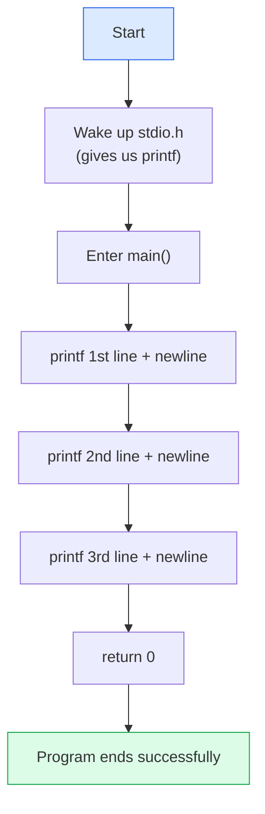
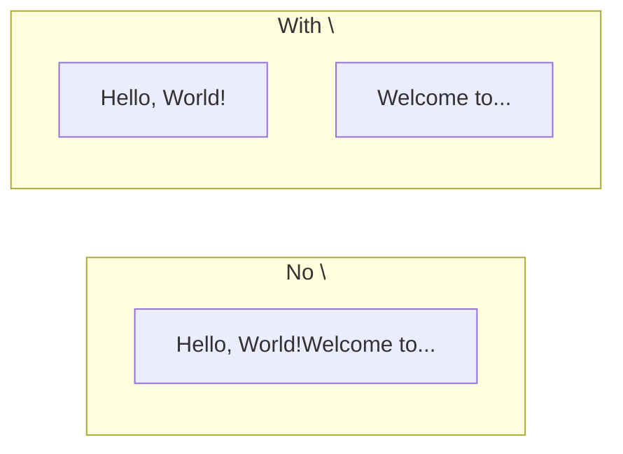

# Problem 01 — Hello World

> **Session 1:** The Road to C — from wires to words
> **Concepts:** `#include`, `main`, `printf`, `\n`, `return 0`

---

## 1. The Problem

Write a C program that prints three lines of text on the screen:

```
Hello, World!
Welcome to the Wameedh C Workshop.
Today we write our first C program.
```

This is the traditional first program of every C developer. It proves that your
compiler is installed, your editor works, and you can produce **output**.

---

## 2. Example Run

```
Hello, World!
Welcome to the Wameedh C Workshop.
Today we write our first C program.
```

There is **no input** in this problem — the program only shows text.

---

## 3. How to Think About It

Every C program needs the same skeleton, even if it does almost nothing:

1. **Bring in a library** so you can print → `#include <stdio.h>`
2. **Write the entry point** where execution starts → `int main(void) { ... }`
3. **Print text** → `printf("...")`
4. **Tell the operating system we finished** → `return 0;`

The `\n` at the end of each string is not decoration: without it, all three
sentences would run together on one line.

---

## 4. Visual Explanation

### Program flow



### What `\n` does



`\n` is called an **escape sequence**. It is a single character that means
"new line".

---

## 5. Solution Walkthrough

| Line in `solution.c` | What it does |
|---|---|
| `#include <stdio.h>` | Includes the **st**andard **i**nput/**o**utput library. `printf` lives here. |
| `int main(void)` | The function where the program begins running. `void` means it takes no arguments. |
| `printf("Hello, World!\n");` | Prints the text; `\n` moves to the next line. |
| `return 0;` | Returns `0` to the system = "everything went fine". |
| `}` | Closes `main`. |

Try deleting one `\n` and re-running — you will see the lines merge. That small
experiment teaches more than reading about it.

---

## 6. Key Takeaways

- `#include <stdio.h>` is required before using `printf`.
- Execution always starts at `main`.
- `\n` is a newline character, not a literal backslash and `n`.
- The `;` ends every statement.
- C is **case-sensitive**: `Main` is not `main`.

---

## 7. Try It Yourself

1. Print your own name on a fourth line.
2. Print a small "business card" using several `printf` calls and a line of
   dashes.
3. Remove `return 0;` and observe the compiler warning (if any).
