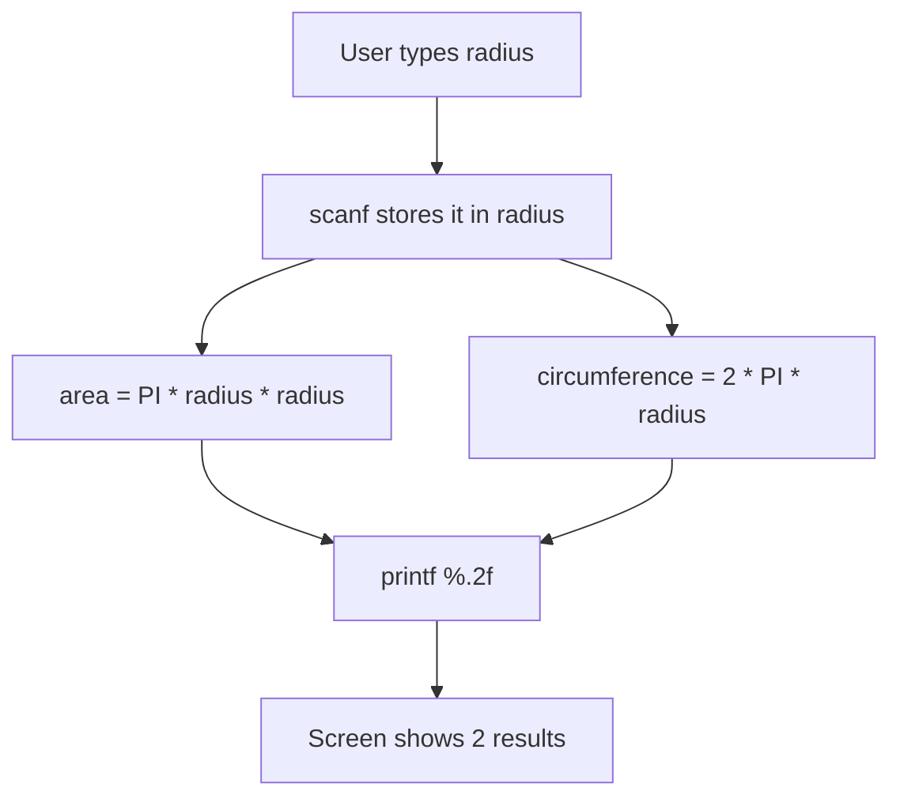
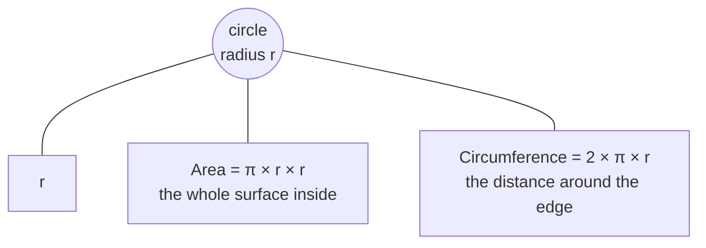
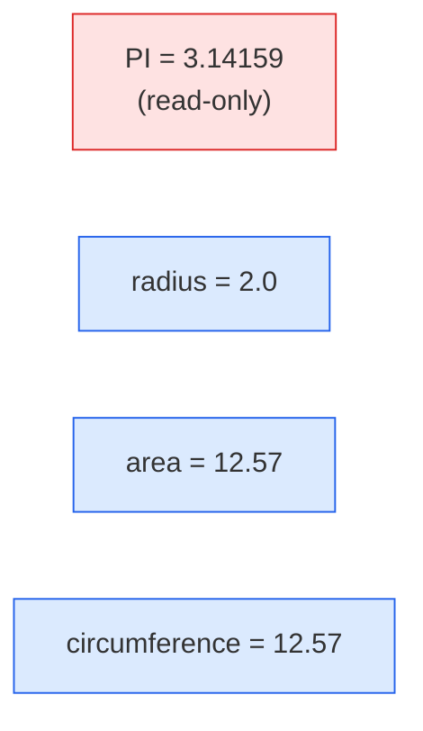

# Problem 02 — Circle Area and Circumference

> **Session 1:** The Road to C
> **Concepts:** `const`, `float`, arithmetic operators, `%f` / `%.2f`, `scanf`

---

## 1. The Problem

Ask the user for the **radius** of a circle, then print:

- the **area** → `π × r²`
- the **circumference** → `2 × π × r`

Use a constant `PI = 3.14159` and show both results with **2 decimal places**.

---

## 2. Example Run

```
Enter the radius: 2
Area          = 12.57
Circumference = 12.57
```

(For `r = 2`: area = `3.14159 × 4 = 12.566…` → `12.57`.)

---

## 3. How to Think About It

1. We need a **constant** for π, because π never changes → `const float PI`.
2. We need a place to store what the user types → a `float radius`.
3. We need two results → `float area`, `float circumference`.
4. We read input with `scanf("%f", &radius)`.
5. We compute, then print with `%.2f`.

**Why `float` and not `int`?** Radius and area can have decimals. If we used
`int`, `3.14` would become `3` and the answer would be wrong.

**Why `const`?** It documents the value and blocks accidental changes. If code
later tries `PI = 3;`, the compiler stops with an error.

---

## 4. Visual Explanation

### Data flow



### Circle picture



### Memory boxes



---

## 5. Solution Walkthrough

| Step | In `solution.c` | Explanation |
|---|---|---|
| Constant | `const float PI = 3.14159f;` | `f` makes it a `float` literal. `const` locks it. |
| Inputs | `scanf("%f", &radius);` | `%f` reads a float; `&` passes the address. |
| Area | `area = PI * radius * radius;` | `×` in C is `*`. |
| Circumference | `2 * PI * radius` | Multiplication is written explicitly; no implied math. |
| Output | `%.2f` | Prints exactly 2 digits after the decimal point. |

---

## 6. Key Takeaways

- `const` = "read-only variable", perfect for `PI`.
- `float` holds decimals; `int` does not.
- `%f` is the placeholder for floats; `%.2f` controls precision.
- C has no implied multiplication — always write `*`.
- `scanf` needs `&` (the address) for numeric types.

---

## 7. Try It Yourself

1. Add the **diameter** (`2 × radius`) to the output.
2. Ask for a `const float RATE` and compute a scaled area (e.g. cost per m²).
3. What happens if the user enters `0`? Is the result still valid? Should we
   check it? (Hint: this leads to `if`, the next session.)
