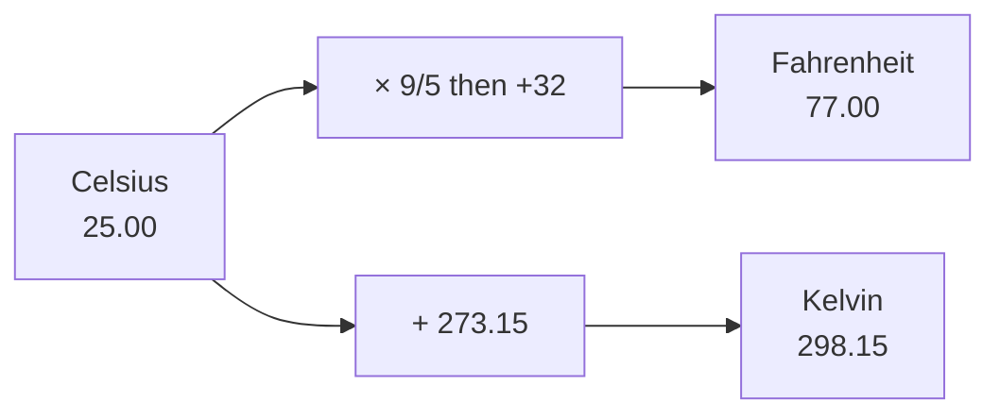
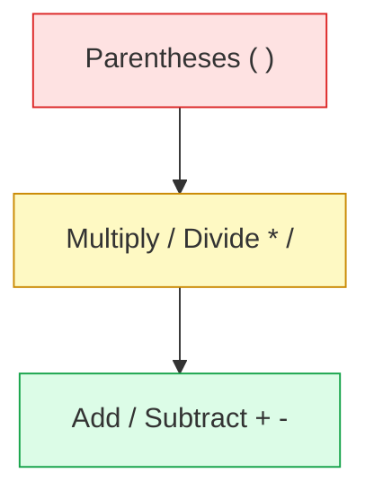
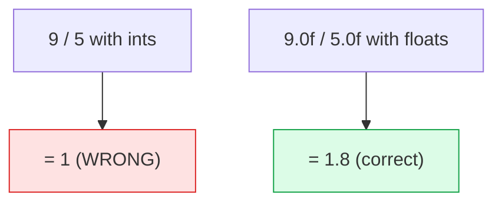

# Problem 03 — Temperature Converter

> **Session 1:** The Road to C
> **Concepts:** `float` arithmetic, operator precedence, `scanf`, formatted output

---

## 1. The Problem

Read a temperature in **Celsius** and convert it to:

- **Fahrenheit** → `(C × 9/5) + 32`
- **Kelvin** → `C + 273.15`

Print all three values with 2 decimal places.

---

## 2. Example Run

```
Enter the temperature in Celsius: 25

--- Results ---
Celsius:    25.00 C
Fahrenheit: 77.00 F
Kelvin:     298.15 K
```

---

## 3. How to Think About It

The "hard" part is not the formulas — it is **operator precedence** and
**integer vs float division**.

- If we write `celsius * 9 / 5`, C evaluates left to right: `celsius * 9`
  first (a float), then `/ 5`. Because the left side is a float, this is fine.
- But if we had two **ints**, `9 / 5` would equal `1`, not `1.8`! That is why
  we write the literals as `9.0f` and `5.0f`.

So the safe habit is: **when a division should be exact, make at least one
operand a float.**

Order of operations (like math):
1. parentheses `( )`
2. multiply / divide `* /`
3. add / subtract `+ -`

In `(celsius * 9.0f / 5.0f) + 32.0f`, the parentheses force the multiplication
and division to happen before the `+ 32`.

---

## 4. Visual Explanation

### Conversion flow



### Precedence towers (which runs first)



Top of the tower happens first.

### Why integer division bites



---

## 5. Solution Walkthrough

| Line | Meaning |
|---|---|
| `float celsius, fahrenheit, kelvin;` | Three float boxes. |
| `scanf("%f", &celsius);` | Read one float from the keyboard. |
| `fahrenheit = (celsius * 9.0f / 5.0f) + 32.0f;` | Parentheses first, then `*` `/`, then `+`. |
| `kelvin = celsius + 273.15f;` | Simple addition. |
| `printf("... %.2f ...")` | 2 decimals for readability. |

---

## 6. Key Takeaways

- `9 / 5` with integers is `1`; use `9.0f / 5.0f` for `1.8`.
- Parentheses make your intention clear and control evaluation order.
- Formulas with real-world meaning (temperature, physics) usually need floats.
- `%.2f` keeps output tidy.

---

## 7. Try It Yourself

1. Add the reverse conversion: read Fahrenheit and output Celsius.
2. Change the precision to `%.4f` and compare.
3. Print an alert if the Celsius value is below `0` (you will need `if`, next
   session).
