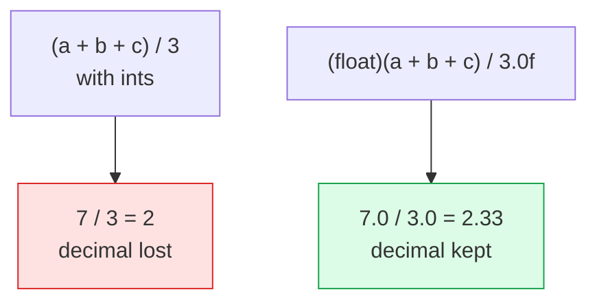
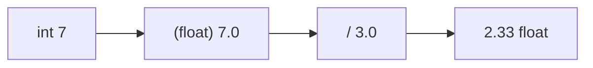
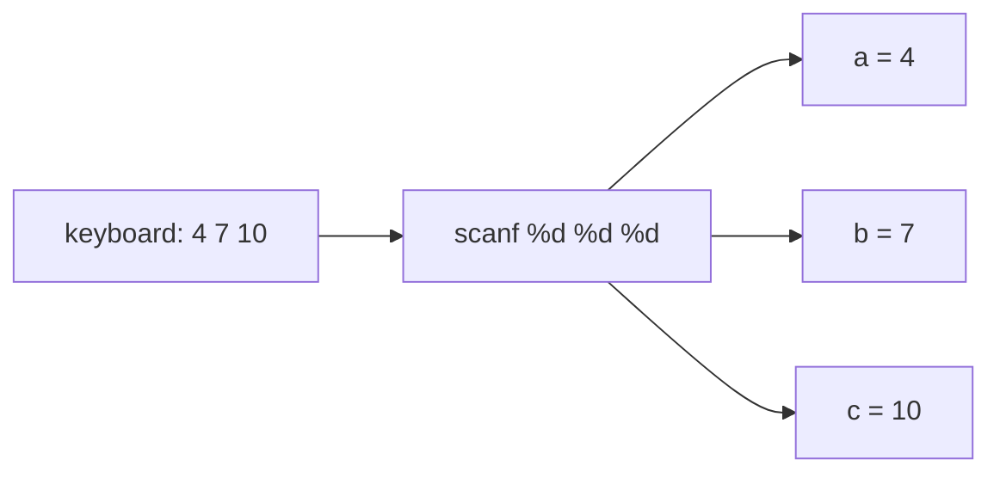

# Problem 04 — Average of Three Numbers

> **Session 1:** The Road to C
> **Concepts:** reading multiple inputs in one `scanf`, type casting, integer vs float

---

## 1. The Problem

Read **three integers** from the user and print:

- their **sum**
- their **average** with 2 decimal places

---

## 2. Example Run

```
Enter three integers: 4 7 10
Sum     = 21
Average = 7.00
```

Another run:

```
Enter three integers: 1 2 4
Sum     = 7
Average = 2.33
```

The second run is the interesting one: `7 / 3 = 2.333…`, so the answer is not a
whole number.

---

## 3. How to Think About It

The trap here is **integer division**.

- `a + b + c` is an `int` (e.g. `7`).
- `7 / 3` with two ints gives `2`, silently throwing away `.333`.
- We must **cast** one side to `float` so the division happens in floating point:

```c
average = (float)(a + b + c) / 3.0f;
```

`(float)` is a **type cast** — it creates a temporary float copy of the sum.

Also note `scanf("%d %d %d", &a, &b, &c);` reads all three numbers in one call.
Spaces in the format string match any amount of whitespace the user types.

---

## 4. Visual Explanation

### Integer division vs float division



### Cast as a "converter"



### Reading three values



---

## 5. Solution Walkthrough

| Step | Code | Explanation |
|---|---|---|
| Declare | `int a, b, c; float average;` | Inputs are ints; the average can be fractional. |
| Read | `scanf("%d %d %d", &a, &b, &c);` | One call, three addresses, three placeholders. |
| Cast | `(float)(a + b + c)` | Turns the integer sum into a float before dividing. |
| Divide | `/ 3.0f` | Float divisor keeps the calculation in float. |
| Print | `%.2f` | Rounds to two decimals. |

---

## 6. Key Takeaways

- Integer / integer = integer (truncated).
- A **cast** `(float)x` changes the type for that expression only.
- One `scanf` can fill several variables at once.
- Choosing the right type **before** doing the math prevents silent bugs.

---

## 7. Try It Yourself

1. Ask for `n` first, then read `n` numbers and average them (needs a loop from
   Session 2).
2. Print the average as a percentage of 100.
3. Try removing the cast and run with `1 2 4` — confirm you get `2.00`.
