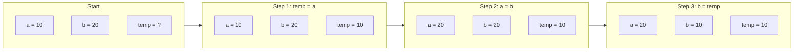
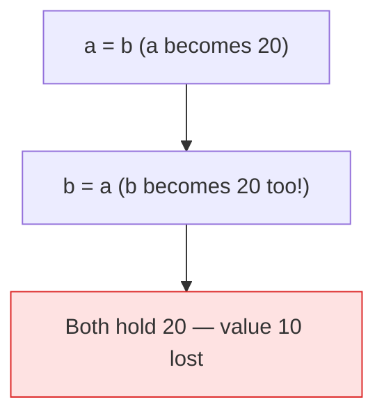

# Problem 05 — Swap Two Numbers

> **Session 1:** The Road to C
> **Concepts:** variables, assignment order, temporary variable

---

## 1. The Problem

Read two integers, `a` and `b`, then **swap** their values so that `a` holds
what was in `b` and vice-versa. Print before and after.

---

## 2. Example Run

```
Enter two integers: 10 20

Before swap: a = 10, b = 20
After swap:  a = 20, b = 10
```

---

## 3. How to Think About It

Imagine two cups: cup **A** holds tea, cup **B** holds coffee. You want to
exchange the liquids. You cannot just pour A into B — you would destroy the
coffee. You need an **empty cup**.

In programming the empty cup is `temp`. The classic three-step swap:

1. `temp = a;` → save `a` (teas) in the empty cup
2. `a = b;` → pour coffee into `a`
3. `b = temp;` → pour the saved tea into `b`

**Why order matters:** if you do `a = b;` first, the original value of `a` is
gone forever. Always save before overwriting.

---

## 4. Visual Explanation

### The three-step dance



### Wrong order



---

## 5. Solution Walkthrough

| Line | Meaning |
|---|---|
| `int a, b, temp;` | Two values plus one spare box. |
| `scanf("%d %d", &a, &b);` | Read both numbers. |
| `temp = a;` | Save original `a`. |
| `a = b;` | Copy `b` into `a`. |
| `b = temp;` | Restore saved value into `b`. |

It looks almost too small to matter — but this exact idea (swapping two values)
reappears in **sorting** and in Session 4 when we swap using **pointers**.

---

## 6. Key Takeaways

- Assignment copies a value; it does not link variables.
- You cannot swap without a temporary storage.
- Read `=` as "gets": `a = b` means "`a` gets the value of `b`".
- This is the foundation of sorting algorithms.

---

## 7. Try It Yourself

1. Swap **three** variables in a cycle (`a→b`, `b→c`, `c→a`).
2. Swap two floats by changing the data types.
3. Try the wrong order and observe the bug — then explain why.
