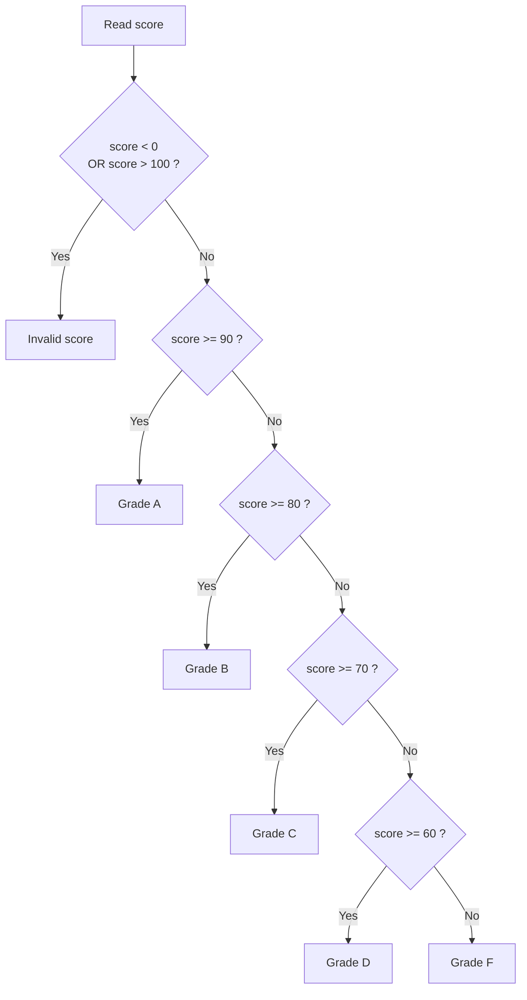
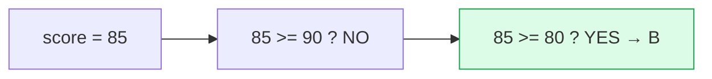

# Problem 01 — Grade Classifier

> **Session 2:** Control Structures
> **Concepts:** `if`, `else if`, `else`, relational operators, range checking

---

## 1. The Problem

Read a score between **0 and 100** and print the matching letter grade:

| Score | Grade |
|:-----:|:-----:|
| 90 – 100 | A |
| 80 – 89  | B |
| 70 – 79  | C |
| 60 – 69  | D |
| 0 – 59   | F |

If the user enters something outside `0–100`, print an error message.

---

## 2. Example Run

```
Enter your score (0-100): 85
Grade: B
```

```
Enter your score (0-100): 150
Invalid score. Please enter a value between 0 and 100.
```

---

## 3. How to Think About It

The scores form an ordered chain. The trick is to check them **from highest to
lowest**:

- If the score is `>= 90` → A (we do not care if it is 95 or 100).
- Otherwise, if it is `>= 80` → B. We already know it is below 90.
- …and so on.

Because C stops at the **first true branch**, we do not need to write
`score >= 80 && score < 90`. The earlier branches already filtered the higher
values. This is why an `else if` chain must be ordered carefully.

We also guard the input first (`< 0 || > 100`) so garbage does not fall through
to "F".

---

## 4. Visual Explanation

### Decision ladder



### First match wins



---

## 5. Solution Walkthrough

| Part | Why |
|---|---|
| `if (score < 0 \|\| score > 100)` | `\|\|` = OR; catches out-of-range input first. |
| `else if (score >= 90)` | Highest band. |
| `else if (score >= 80)` | Only reached when the previous check failed. |
| `else` | The fallback: anything below 60. |
| `break` | Not used here — `if` chains do not need it. |

---

## 6. Key Takeaways

- `else if` checks are evaluated **top to bottom**, and only the first true one
  runs.
- Order the conditions from most specific / highest to lowest.
- Bounds check first to handle bad input.
- `&&` = AND, `||` = OR, `!` = NOT.

---

## 7. Try It Yourself

1. Add a `+` / `-` style grade (e.g. 87 → B+).
2. Print an encouraging message for each grade.
3. Rewrite the range check as two separate `if`s and explain why one `||` is
   shorter.
