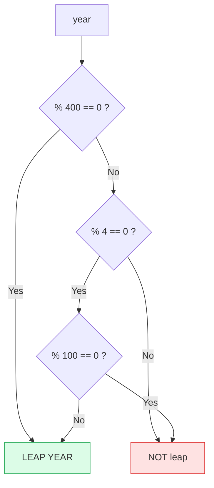

# Problem 02 — Leap Year Checker

> **Session 2:** Control Structures
> **Concepts:** logical operators `&&` / `||`, `%` (modulo), combined conditions

---

## 1. The Problem

Ask the user for a year and tell them whether it is a **leap year**.

Rules (the tricky part):

- Divisible by **4** → normally a leap year
- Divisible by **100** → **not** a leap year
- Divisible by **400** → leap year again

So: 2000 ✅, 1900 ❌, 2024 ✅, 2023 ❌.

---

## 2. Example Run

```
Enter a year: 2000
2000 is a leap year.
```

```
Enter a year: 1900
1900 is NOT a leap year.
```

---

## 3. How to Think About It

"Divisible by" means **the remainder is 0**, written with the modulo operator
`%`:

```
year % 4 == 0        -> year is divisible by 4
```

Now translate the rules into one condition. The two ways a year can be leap:

1. It is divisible by **400**, **or**
2. It is divisible by **4** *and* **not** divisible by **100**.

```c
if ((year % 400 == 0) || (year % 4 == 0 && year % 100 != 0))
```

`&&` binds tighter than `||`, but we still add parentheses to make the meaning
obvious to the reader. `!=` means "not equal to".

---

## 4. Visual Explanation

### Rule flow



### Truth table of the combined condition

| %400==0 | %4==0 | %100==0 | Result |
|:---:|:---:|:---:|:---:|
| ✅ | ✅ | ✅ | Leap (via 400) |
| ❌ | ✅ | ✅ | Not leap |
| ❌ | ✅ | ❌ | Leap |
| ❌ | ❌ | ❌ | Not leap |

---

## 5. Solution Walkthrough

| Code | Meaning |
|---|---|
| `year % 400 == 0` | Special 400-year rule. |
| `year % 4 == 0 && year % 100 != 0` | Normal leap year, excluding century years. |
| `(A) \|\| (B)` | Leap if either special case is true. |
| `else` | Everything else is a common year. |

---

## 6. Key Takeaways

- `%` returns the remainder; `x % y == 0` tests divisibility.
- `&&` requires both sides true; `||` requires one.
- `!`, `&&`, `||` have an order of precedence — parentheses avoid confusion.
- Real-world rules often translate directly into boolean expressions.

---

## 7. Try It Yourself

1. Loop from year 1900 to 2100 and print only leap years (uses `for`).
2. Add a check for invalid negative years.
3. Print *why* a year is not leap (century rule vs not divisible by 4).
