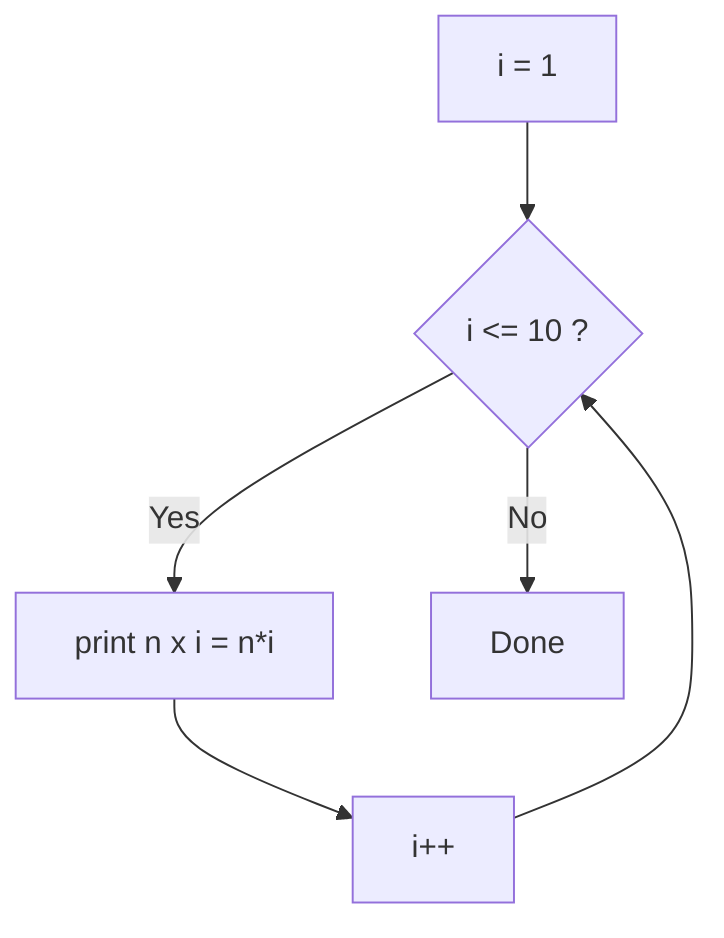
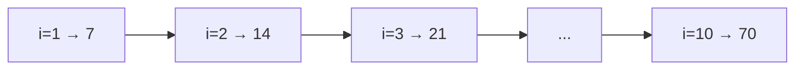
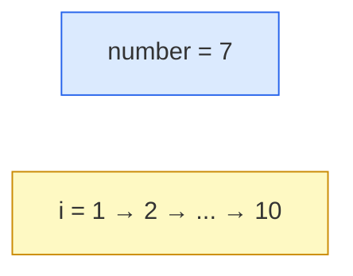

# Problem 03 — Multiplication Table

> **Session 2:** Control Structures
> **Concepts:** `for` loop, counter variable, formatted output with width

---

## 1. The Problem

Read a number `n` and print its multiplication table from `1` to `10`.

---

## 2. Example Run

```
Enter a number: 7

Multiplication table of 7:
------------------------
7 x  1 =  7
7 x  2 = 14
7 x  3 = 21
7 x  4 = 28
7 x  5 = 35
7 x  6 = 42
7 x  7 = 49
7 x  8 = 56
7 x  9 = 63
7 x 10 = 70
```

---

## 3. How to Think About It

We repeat the *same* action ten times. That is the textbook use of a `for`
loop. Three questions to design any `for` loop:

| Question | Answer here |
|---|---|
| Where do I start? | `i = 1` |
| When do I stop? | while `i <= 10` |
| How do I move forward? | `i++` (add 1) |

```c
for (int i = 1; i <= 10; i++) { ... }
```

Inside the body, `i` changes each round, so `n * i` produces a new line each
time. That is the whole loop.

**Output formatting bonus:** `%2d` and `%3d` reserve a fixed width so the
numbers line up in neat columns. Without them the table looks ragged.

---

## 4. Visual Explanation

### Loop cycle



### Iteration table (`n = 7`)



### Where it lives in memory



---

## 5. Solution Walkthrough

| Line | Meaning |
|---|---|
| `for (int i = 1; i <= 10; i++)` | Start at 1, run while `i` is at most 10, add 1 each time. |
| `number * i` | The product for the current row. |
| `"%d x %2d = %3d\n"` | `%2d`/`%3d` pad to 2/3 characters for alignment. |

---

## 6. Key Takeaways

- `for (init; condition; update)` is the counting loop.
- The condition is checked **before** each round.
- Forgetting `i++` causes an infinite loop.
- Field width in `printf` (e.g. `%3d`) makes columns line up.

---

## 7. Try It Yourself

1. Ask how high the table should go (replace `10`).
2. Print tables for all numbers from 1 to `n` (nested loops).
3. Print only even rows using `continue`.
