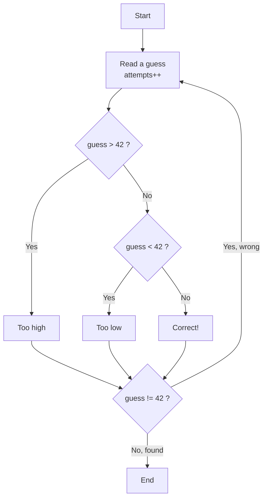
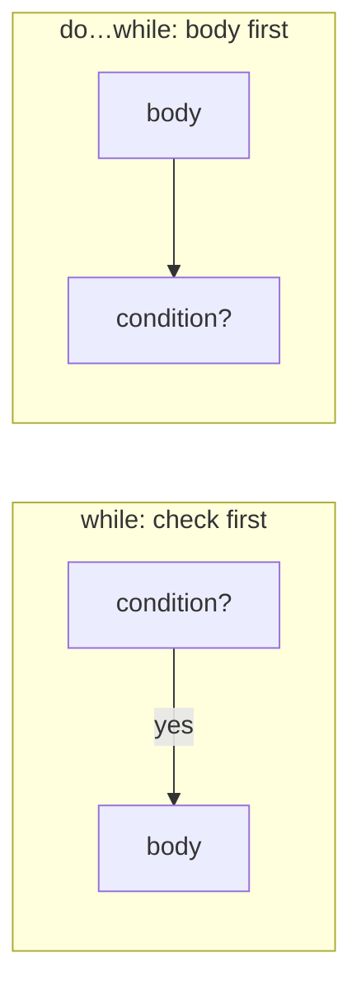

# Problem 04 — Number Guessing Game

> **Session 2:** Control Structures
> **Concepts:** `do…while`, `if/else if/else`, counter variable, loop termination

---

## 1. The Problem

The secret number is **42**. Repeatedly ask the user to guess until they find
it. After each wrong guess, say whether it is **too high** or **too low**.
When they succeed, tell them how many attempts it took.

---

## 2. Example Run

```
Guess the secret number (between 1 and 100)!
Your guess: 50
Too high! Try again.
Your guess: 25
Too low! Try again.
Your guess: 42
Correct! You found it in 3 attempt(s).
```

---

## 3. How to Think About It

We do not know in advance how many guesses the user needs, so a `while`-family
loop fits. But the user must guess **at least once** — that is exactly what
`do…while` guarantees:

```c
do {
    /* read a guess */
} while (guess != SECRET);
```

- `do…while` runs the body **first**, then checks the condition.
- The loop continues *while the guess is wrong*.
- We increment `attempts` inside the body so it counts every guess.

Comparing the guess with the secret is a three-way decision, which is why we
use an `if / else if / else` chain: too high, too low, or correct.

---

## 4. Visual Explanation

### do…while flow



Notice the body is entered **before** the condition is ever tested — that is
the whole point of `do…while`.

### while vs do…while



---

## 5. Solution Walkthrough

| Line | Meaning |
|---|---|
| `const int SECRET = 42;` | The fixed answer. `const` prevents accidental change. |
| `int attempts = 0;` | Counter, starts at zero. |
| `do { ... } while (guess != SECRET);` | Guarantees one guess, repeats until correct. |
| `attempts++;` | Counts each guess. |
| `if / else if / else` | Three-way comparison. |

---

## 6. Key Takeaways

- `do…while` runs at least once; `while` may run zero times.
- A counter variable needs initialization, updating, and use.
- Comparing values uses `==`, not `=` (`=` assigns!).
- A loop stops when its condition becomes false.

---

## 7. Try It Yourself

1. Make the secret a **random** number (later, with `rand()`).
2. Limit the player to 5 attempts using `break` when they run out.
3. Warn if the guess is outside `1–100`.
