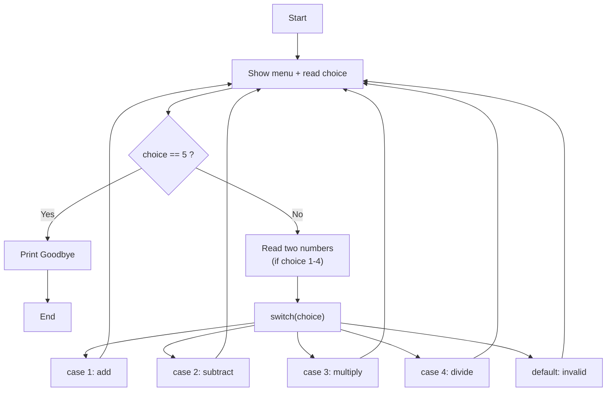
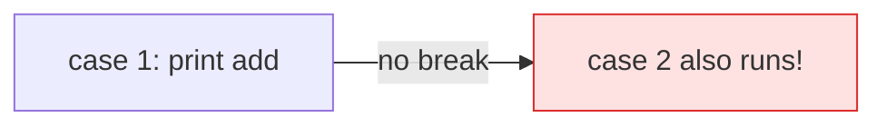

# Problem 05 — Simple Calculator Menu

> **Session 2:** Control Structures
> **Concepts:** `switch` / `case` / `break` / `default`, `while (1)`, `break`

---

## 1. The Problem

Show a menu that repeats until the user chooses to exit:

```
1) Add   2) Subtract   3) Multiply   4) Divide   5) Exit
```

Read the choice, read two numbers, print the result. Handle an invalid option
and division by zero.

---

## 2. Example Run

```
===== Calculator =====
1) Add
2) Subtract
3) Multiply
4) Divide
5) Exit
Choose an option: 3
Enter two numbers: 6 7
Result: 42.00

===== Calculator =====
...
Choose an option: 5
Goodbye!
```

---

## 3. How to Think About It

Two ideas combine here:

1. **A menu is a repeated choice** → wrap everything in `while (1)` (an
   "infinite" loop) and use `break` to leave when the user picks Exit.
2. **Many fixed options** are cleaner with `switch` than a long `else if`
   chain.

```c
switch (choice) {
    case 1: ...; break;
    case 2: ...; break;
    ...
    default: ...;   /* invalid choice */
}
```

Key `switch` facts:

- The expression must be an **int or char** (not float, not string).
- `break` ends the case; without it execution **falls through** into the next
  case.
- `default` runs when no case matches — like the final `else`.

We also guard before dividing: `if (b == 0)` avoids a crash.

---

## 4. Visual Explanation

### Menu loop



### Fall-through warning



Always end a case with `break` unless you *want* fall-through.

---

## 5. Solution Walkthrough

| Part | Why |
|---|---|
| `while (1)` | Repeats forever until a `break` is hit. |
| `if (choice == 5) { ...; break; }` | Exit path. |
| `if (choice >= 1 && choice <= 4)` | Only read numbers for valid operations. |
| `switch (choice)` | Clean multi-way branching. |
| `default:` | Catches anything not 1–5. |
| `if (b == 0)` | Prevents division by zero. |

---

## 6. Key Takeaways

- `switch` is ideal for a fixed set of integer/char options.
- `break` exits a `case` (or a loop).
- `default` handles unexpected input.
- `while (1)` + `break` is a common "menu until exit" pattern.
- Always protect division by zero.

---

## 7. Try It Yourself

1. Add an operation: modulus (`%`, integer only) or power.
2. Keep a running total across operations.
3. Replace the `switch` with an `else if` chain and compare readability.
