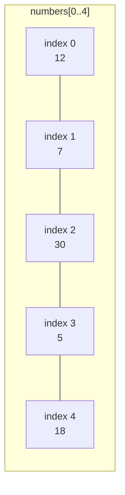
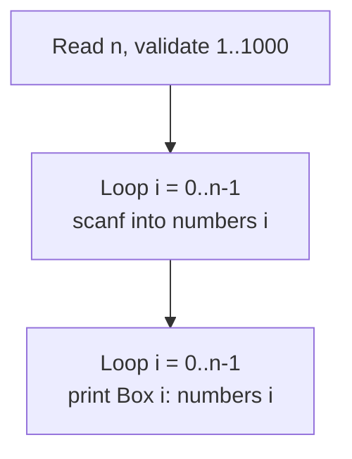
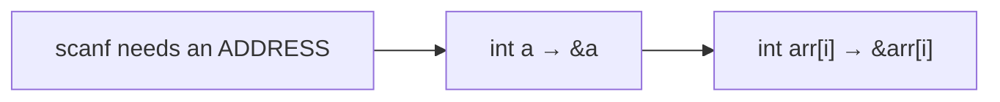

# Problem 01 — Print My Array

> **Session 3:** Arrays
> **Concepts:** array declaration, indexing, filling an array with a loop, looping over an array
> **Difficulty:** Easy

---

## 1. The Problem

Ask the user how many numbers they want (`n`), read `n` integers into an
array, then print each number with its index — like looking at every drawer
and saying what's inside it.

Reject `n` outside `1 … 1000`.

---

## 2. Example Run

```
How many numbers? 5
Enter 5 numbers: 12 7 30 5 18

--- My Array ---
Box 0: 12
Box 1: 7
Box 2: 30
Box 3: 5
Box 4: 18
```

---

## 3. How to Think About It

An **array** is a row of boxes of the same type, numbered from **0**.
Before using it you must reserve all boxes at once, with a maximum size:

```c
int numbers[MAX_SIZE];   /* 1000 boxes reserved, we use only the first n */
```

> New in this problem: **`MAX_SIZE` is a global variable**. It is the first
> variable in your program to be declared *outside* every function.
>
> | | Global variable | Local variable |
> |---|---|---|
> | Declared | at the top of the file, outside `main` | inside a function |
> | Who can see it | **every** function in the file | only that function |
> | How long it lives | the whole program run | dies when its function ends |
>
> Why put the max size in a global variable? Every part of the program
> agrees on the same limit, and if you ever change 1000 to 2000, you edit
> **one line** — the spirit of "write once, use everywhere" applied to a
> single number.

The plan has two steps, and both need the same loop:

1. **Fill:** loop `i = 0 … n-1` and `scanf` into `numbers[i]`.
2. **Print:** loop again `i = 0 … n-1` and `printf` from `numbers[i]`.

> Rule to memorize: the **last** valid box is index **n − 1**, never `n`.
> Writing `numbers[n]` reads an empty box that belongs to nobody (out of
> bounds).

---

## 4. Visual Explanation

### The array in memory (`n = 5`)



### One array, two loops



### Why `&numbers[i]`



`scanf` always wants the *address* of the box to write into. In session 1
we wrote `&a`; now the box is `numbers[i]`, so the address is
`&numbers[i]`.

---

## 5. Solution Walkthrough

| Line | Meaning |
|---|---|
| `int MAX_SIZE = 1000;` | **Global variable**: declared outside all functions (above `main`), visible to every function, alive for the whole run. |
| `int numbers[MAX_SIZE];` | Reserve 1000 `int` boxes (only the first `n` are used). |
| `scanf("%d", &n);` | Read how many numbers the user has. |
| `if (n <= 0 \|\| n > MAX_SIZE)` | Bounds check: never trust the user. |
| `scanf("%d", &numbers[i]);` | Fill box `i` — every element needs its own `&`. |
| `printf("Box %d: %d\n", i, numbers[i]);` | Label each value with its index. |

---

## 6. Key Takeaways

- Declare an array with a fixed maximum size, use only `n` boxes.
- Indexing starts at `0` and ends at `n - 1`.
- `scanf` needs `&` on every single element: `&numbers[i]`.
- Two loops using the *same* indices are the standard way to fill then read
  an array.

---

## 7. Try It Yourself

1. Print the array **backwards** (start `i` at `n - 1` and go down to `0`).
2. Print only the boxes at even indices (use `i += 2`).
3. Double every value in the array, then print it again.

---

## 8. Level-Up Preview — Let the User Size the Array

You have not needed this yet, but it is coming in Problem 03: the array
does not have to be pre-sized by a fixed `MAX_SIZE` — **the user can
choose the size at runtime**, and C will create the array right then.

This program (a cleaned-up version of a pattern from your instructor)
shows the idea:

```c
#include <stdio.h>

int MAX_SIZE = 1000;   /* global: the safety ceiling, not the size */

int main()
{
    int size;

    printf("Enter the size of the array: ");
    scanf("%d", &size);

    if (size <= 0 || size > MAX_SIZE) {          /* the ceiling guards it */
        printf("Please enter a value between 1 and %d.\n", MAX_SIZE);
        return 1;
    }

    int array[size];          /* the USER decided the number of boxes! */

    for (int i = 0; i < size; i++) {
        array[i] = i + 1;     /* box i gets the value i+1 */
    }

    for (int i = 0; i < size; i++) {
        printf("Number at index %d is %d\n", i, array[i]);
    }

    return 0;
}
```

Stop and stare at `int array[size];`:

- Other declarations so far used a **global variable** (`MAX_SIZE`) — the
  space was booked before the program even ran. Here the size comes from
  the user **while the program is running**, so the array is created at
  that moment. This works in standard C.
- **Order matters now**: the declaration must come **after** the `scanf`.
  C cannot create an array whose size the program doesn't know yet.
- The **global `MAX_SIZE` changed jobs**: it is no longer the array's
  own size — it is the **ceiling** that stops the user from asking for a
  million boxes (or zero, or a negative number).

Keep this pattern in mind; Problem 03 uses it.

---

> **Note:** if you did not understand anything in this problem, just paste it
> into ChatGPT or your AI tool and ask it to explain — and you will learn.
