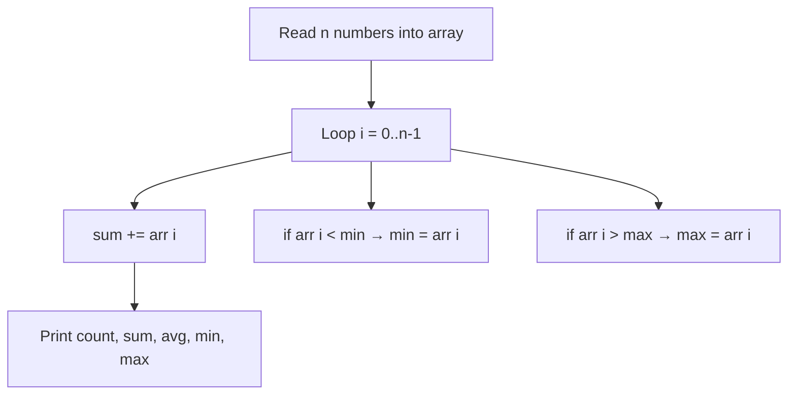
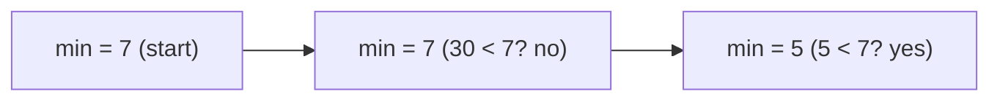
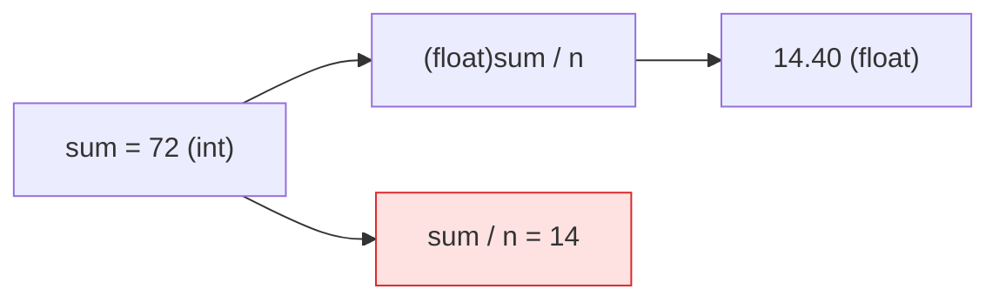

# Problem 02 — Array Statistics

> **Session 3:** Arrays
> **Concepts:** loops over arrays, running sum, average with a cast, min/max tracking
> **Difficulty:** Easy-Medium

---

## 1. The Problem

Read `n` integers into an array (validate `n` in `1 … 1000`), then print:

- count
- sum
- average (2 decimals)
- minimum
- maximum

---

## 2. Example Run

```
How many numbers? 5
Enter 5 numbers: 12 7 30 5 18

--- Statistics ---
Count:   5
Sum:     72
Average: 14.40
Minimum: 5
Maximum: 30
```

---

## 3. How to Think About It

Four "walking tours" of the same row of boxes — each tour is just one loop:

- **sum:** every box, add its content to a running total.
- **min:** carry the smallest value seen so far; replace it when you see
  something smaller.
- **max:** same idea, but with "bigger".
- **average:** not a loop at all — `average = (float)sum / n`.

All four can live in the *same* loop (the solution does that), because they
all visit every box exactly once.

**The min/max trap:** initialize `min` and `max` with `numbers[0]`, **not**
with `0`. If `min` started at `0`, a list of all-positive numbers (all
bigger than 0) would never update it and you would print a wrong answer.

**The average trap:** `sum / n` with two **int**s chops off the decimals
(integer division). Cast one side to float first: `(float)sum / n`.

---

## 4. Visual Explanation

### One loop, four jobs



### Min tracking on a walk (`7, 30, 5`)



### The average cast



---

## 5. Solution Walkthrough

| Line | Meaning |
|---|---|
| `int min = numbers[0];` | Start min/max at the **first element**, not 0. |
| `sum += numbers[i];` | Extend the running total with the current box. |
| `if (numbers[i] < min) …` | Found a new smallest value — save it. |
| `if (numbers[i] > max) …` | Found a new largest value — save it. |
| `float average = (float)sum / n;` | Cast so decimals survive. |

---

## 6. Key Takeaways

- A single loop can do several jobs at once if they all need every element.
- Min/max must be initialized with a **real element** (`numbers[0]`).
- Integer division loses the decimal part — cast before dividing: `(float)a / b`.
- These statistics functions are the exact skills you will turn into
  **functions** in Session 4 (Problem 03). Remember the logic well.

---

## 7. Try It Yourself

1. Count how many numbers are **above** the average (second loop).
2. Print the numbers between min and max positions.
3. Support negative numbers and check min/max still work.

---

> **Note:** if you did not understand anything in this problem, just paste it
> into ChatGPT or your AI tool and ask it to explain — and you will learn.
