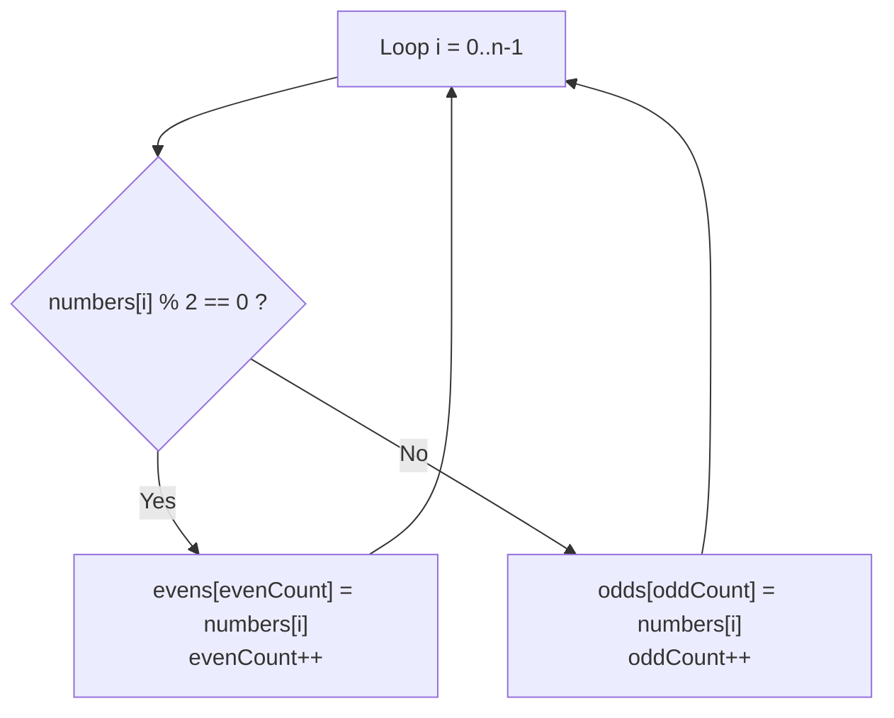
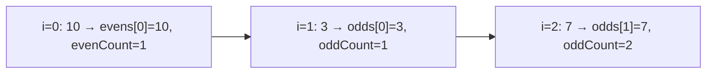

# Problem 03 — Evens and Odds

> **Session 3:** Arrays
> **Concepts:** working with **two arrays at once**, counter variables, `if/else` inside a loop
> **Difficulty:** Medium

---

## 1. The Problem

Read `n` integers into an array, then split them: put the even numbers into
one array and the odd numbers into another. Print both arrays and how many
each one holds.

---

## 2. Example Run

```
How many numbers? 6
Enter 6 numbers: 10 3 7 8 20 11

Even numbers (3): 10 8 20
Odd numbers  (3): 3 7 11
```

---

## 3. How to Think About It

This problem is really a **sorting hat**: one by one, send each number to
one of two tables.

Three ingredients:

1. Two extra arrays: `int evens[MAX]; int odds[MAX];`
2. Two counters: `int evenCount = 0; int oddCount = 0;` — *these are the
   position counters of the new arrays.*
3. One `for` loop over the input, with an `if/else` inside:

The key pattern — **counter as index**:

```c
if (number is even) {
    evens[evenCount] = numbers[i];
    evenCount++;              /* next even goes in the NEXT box */
} else {
    odds[oddCount] = numbers[i];
    oddCount++;
}
```

Notice: we do **not** use `i` as the index of `evens`/`odds`. Box `i` of a
new array means "the i-th *input*", but we want "the i-th *even so far*".
That is why the counters exist.

**Even test:** `numbers[i] % 2 == 0`.

---

## 4. Visual Explanation

### The sorting hat in action



### Trace (`10, 3, 7`)



Notice the input index `i` and the output counters step **separately** —
that is the whole lesson of this problem.

---

## 5. Solution Walkthrough

| Line | Meaning |
|---|---|
| `int evens[MAX], odds[MAX];` | Two empty rows of boxes. |
| `int evenCount = 0, oddCount = 0;` | Each counter also means "how full". |
| `numbers[i] % 2 == 0` | The even test. |
| `evens[evenCount] = numbers[i];` | Store at the next free even box. |
| `evenCount++;` | Move to the next free even box. |
| `for (int i = 0; i < evenCount; i++)` | Both arrays get printed with THEIR counters, not `n`. |

---

## 6. Key Takeaways

- A counter variable can serve as the **write index** of a new array.
- The input index `i` and the output counters are **different** counters.
- After the loop, `evenCount` is the true length of `evens` — always loop
  with it when printing, instead of re-testing evenness.
- This "counted copy into a new array" pattern appears everywhere (filter,
  search results, later: filtering by any rule).

---

## 7. Try It Yourself

1. Also count and print how many zeros were entered.
2. Make a third array for negatives (or zero).
3. Do the split without storing — just print evens in one loop, then odds
   in another. What is the advantage of the version with arrays?

---

> **Note:** if you did not understand anything in this problem, just paste it
> into ChatGPT or your AI tool and ask it to explain — and you will learn.
