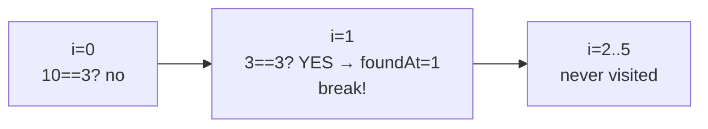
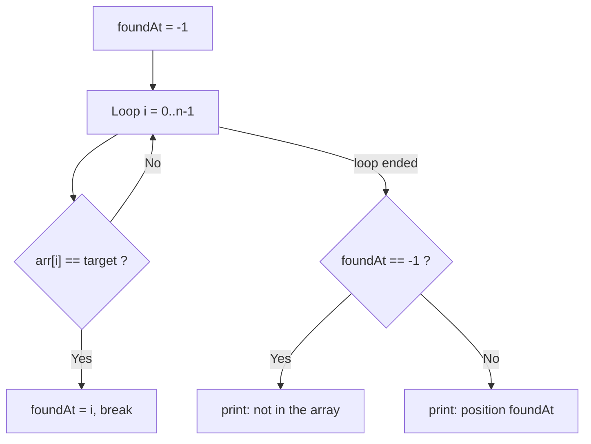
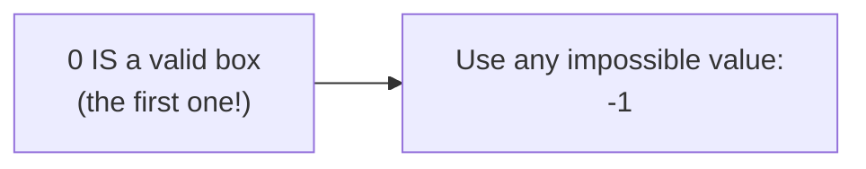

# Problem 04 — Linear Search

> **Session 3:** Arrays
> **Concepts:** searching an array with a loop, the `found` flag pattern, first occurrence vs all occurrences
> **Difficulty:** Medium

---

## 1. The Problem

Read `n` integers into an array, then ask for a `target` value. Search the
array and print **the position of the first occurrence**, or a message if
the value is not there.

Then extend it: print **every** position where the target appears.

---

## 2. Example Run

```
How many numbers? 6
Enter 6 numbers: 10 3 7 8 20 3
Which value do you want to find? 3

First occurrence of 3 is at position 1.
3 also appears at positions: 1 5
```

If the target is missing:

```
Which value do you want to find? 99
99 is not in the array.
```

---

## 3. How to Think About It

Linear search = walk through the array from box 0 to box n−1 and compare
each box with the target. The moment you find it, you *could* stop — that
is what we do for the first occurrence.

Two patterns inside the same loop:

**Pattern A — the `found` flag (first occurrence):**

```c
int foundAt = -1;                       /* -1 = "not seen yet" */
for (int i = 0; i < n; i++) {
    if (numbers[i] == target) { foundAt = i; break; }
}
```

- `foundAt` starts at `-1`, a value that **can never be a real index** —
  so afterwards, `foundAt == -1` perfectly means "absent".
- `break` exits the loop early: no reason to keep walking once we know.

**Pattern B — report all matches (same loop, no `break`, no flag):** just
print every position where the check is true. All match positions are
gathered into a "positions" array with the counter-index pattern from
Problem 03.

The `==` comparison is the standard trick of C searching: check *equality*
and remember *where*.

---

## 4. Visual Explanation

### Searching for 3 in `10, 3, 7, 8, 20, 3`



### First-occurrence flow



### Why -1 and not 0 as "not found"?



---

## 5. Solution Walkthrough

| Line | Meaning |
|---|---|
| `int foundAt = -1;` | "Nothing found yet." `-1` is never a valid index. |
| `if (numbers[i] == target)` | Equality test — the heart of linear search. |
| `break;` | Stop the loop; we only needed the first hit. |
| `if (foundAt == -1)` | Distinguish "found" from "absent" after the search. |
| `positions[posCount++] = i;` | Every match position saved, like Problem 03. |

---

## 6. Key Takeaways

- **Linear search** = a loop + an equality test. That is 90% of C searching.
- Use an **impossible sentinel value** (`-1`) instead of a boolean to mean
  "not found" — it carries the position itself.
- `break` = "I have my answer, stop looking."
- Searching for *all* occurrences is the same loop **without** `break`.
- This same "walk the array" logic returns in Session 4 inside reusable
  functions.

---

## 7. Try It Yourself

1. Stop early without `break` — count down from `n-1`? What changes?
2. Find and report the **last** occurrence instead of the first (never
   overwrite an earlier `foundAt`, or walk from the end).
3. Count how many times the target appears (a `found` counter instead of
   `foundAt`).

---

> **Note:** if you did not understand anything in this problem, just paste it
> into ChatGPT or your AI tool and ask it to explain — and you will learn.
