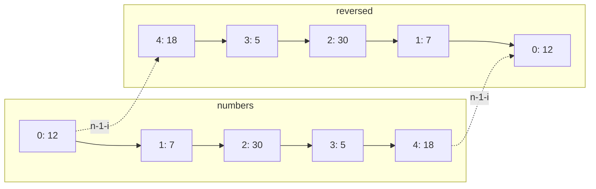
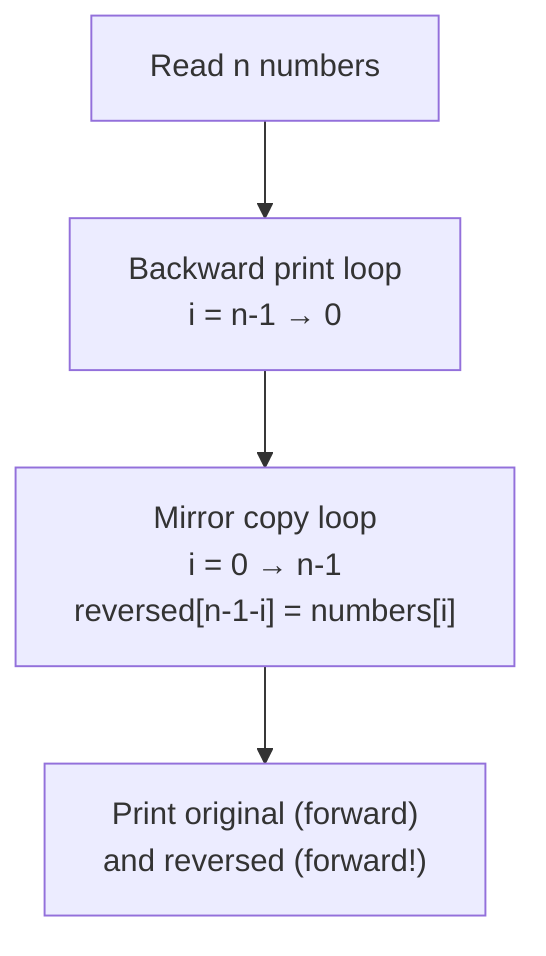
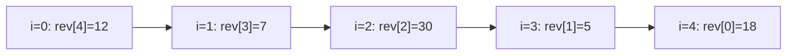

# Problem 05 — Reverse Array

> **Session 3:** Arrays
> **Concepts:** backward loop (`i--`), building a mirrored copy in a **second array**, index arithmetic `n - 1 - i`
> **Difficulty:** Level-Up (hardest of this session)

---

## 1. The Problem

Read `n` integers into an array, then do two things:

1. Print the array **in reverse order** (a backward walk).
2. Store the reversed version into a **second array**, then print both the
   original and the reversed arrays side by side.

---

## 2. Example Run

```
How many numbers? 5
Enter 5 numbers: 12 7 30 5 18

Backwards: 18 5 30 7 12

Original: 12 7 30 5 18
Reversed: 18 5 30 7 12
```

---

## 3. How to Think About It

### Part 1 — walking backwards

Printing in reverse needs **no extra memory** at all: the loop is the same
arrow, drawn the other way.

```c
for (int i = n - 1; i >= 0; i--) { ... }
```

Read it out loud: *start at the last box (`n - 1`), go down while `i` has
not passed 0, step `-1` each round.*

### Part 2 — mirroring into a second array

We *could* re-print backwards, but the point of this problem is to build a
real reversed array: a second row of boxes whose contents are the first
array seen in a mirror.

The mirror formula: **`reversed[n - 1 - i] = numbers[i]`**

- `i = 0` (first box)  → `n - 1 - 0` (last box)
- `i = 1` (second box) → `n - 1 - 1` (second-to-last box)
- `i = n - 1` (last box) → `0` (first box)

This problem **needs no swap** — we never edit the original. We only copy
pair-wise in opposite directions. (Swapping in place is a different
technique that requires functions — that comes in Session 4, later in the
course material.)

### The mental model



---

## 4. Visual Explanation

### The two loops



### Trace of `reversed[n - 1 - i] = numbers[i]` (`n = 5`)



Both loops then print **forward** (`i = 0 … n-1`) — backwards walking was
needed only for reading.

---

## 5. Solution Walkthrough

| Line | Meaning |
|---|---|
| `int i = n - 1; i >= 0; i--` | Loop that counts **down**. |
| `reversed[n - 1 - i]` | The mirror address of box `i`. |
| `printf("%d ", numbers[i]);` | Dedicate one loop per sentence in the output. |
| `int reversed[5]` | Second array — same size `MAX`, we use `n` boxes. |

---

## 6. Key Takeaways

- A loop can walk **either direction**: `i++` forward, `i--` backward.
- `n - 1 - i` maps the first element to the last one — the mirror formula.
- Reversing by **copy** is memory-safe and swap-free; you keep the original.
- Starting the loop at `n - 1` is legal only if you remembered to check
  `n >= 1` first (we did — why must this be true before `i = n - 1`?).

---

## 7. Try It Yourself

1. Print the reversed array backwards too (what should the output look like?).
2. Mirror the array **onto itself** using a helper: `numbers[i] =
   numbers[n-1-i]` for half the boxes — what goes wrong in the second half?
   (Ask your AI tool — this is the road to real swapping.)
3. Combine with Problem 03: reverse only the even numbers.

---

> **Note:** if you did not understand anything in this problem, just paste it
> into ChatGPT or your AI tool and ask it to explain — and you will learn.
