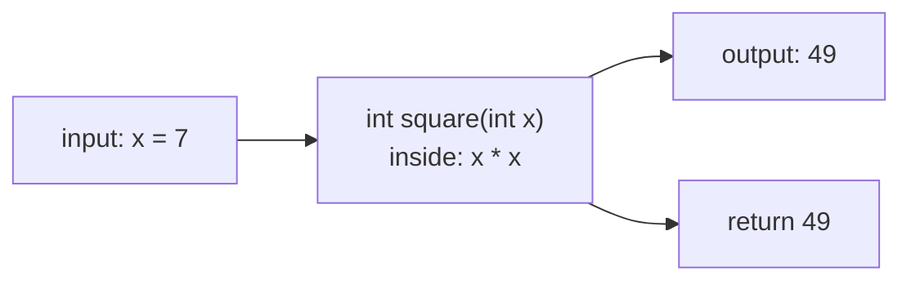
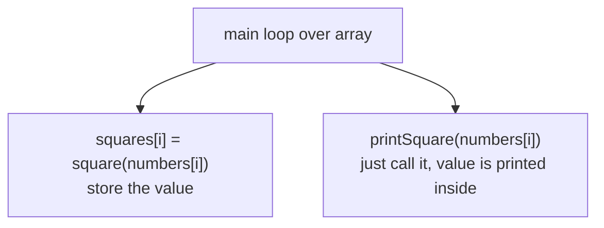
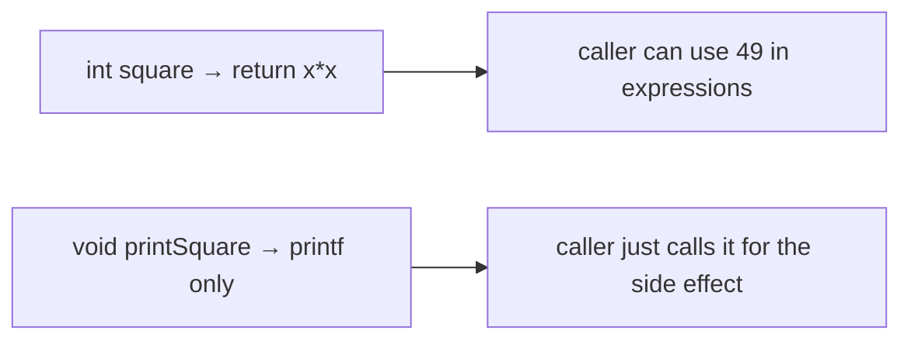

# Problem 01 — Square Machine

> **Session 4:** Functions
> **Concepts:** your first functions — declaration, parameters, return values, and the difference between a **typed** function and a **void** function
> **Difficulty:** Easy

---

## 1. The Problem

Read 3 integers into an array. For each number, print its square — but do
the squaring **inside functions, not in `main`**:

1. `int square(int x)` — a **typed** function: it *returns* the result.
2. `void printSquare(int x)` — a **void** function: it prints and returns
   nothing.

Use **both** functions in `main` and notice the different ways they are
called.

---

## 2. Example Run

```
Enter 3 numbers: 2 7 10

Using square()    : 4 49 100
Using printSquare(): 2 squared is 4
                     7 squared is 49
                     10 squared is 100
```

---

## 3. How to Think About It

A function is a **machine**: input goes in one slot, work happens inside,
something comes out (or maybe it just makes noise and returns nothing).

The two styles of the same task:

| | `int square(int x)` | `void printSquare(int x)` |
|---|---|---|
| Returns a value? | Yes — `return x * x;` | No |
| Keeps the result? | `s = square(7);` stores it for later | Result lives only on the screen |
| Good for | calculations, reuse in expressions | printing, announcement work |

Two new rules to internalize:

1. **The parameter is a copy.** `square(7)` receives the *value* 7.
   Changing `x` inside the function never changes the caller's variable.
   (This is *pass by value* — check the Session 4 course for details.)
2. **A typed function must `return` on every path** through its `if`s.

> **Side note:** `int SIZE = 3;` at the top of the solution is a **global
> variable** — declared outside every function, so any function could use
> it, and it stays alive the whole program run. A variable declared
> *inside* a function (like `numbers` here) is a **local variable** and
> dies when that function ends.

The **mentality** switch: `main` should become less like a factory and more
like a manager — it reads input, delegates work to machines (functions),
and arranges the workers' results. You will reuse `square` in the next
problems.

---

## 4. Visual Explanation

### A function as a machine



### The two call styles



### Why void has no return value



---

## 5. Solution Walkthrough

| Line | Meaning |
|---|---|
| `int square(int x)` | The function *header*: type, name, one int parameter. |
| `return x * x;` | Send the result back to the caller. |
| `void printSquare(int x)` | `void` = returns nothing, prints instead. |
| `squares[i] = square(numbers[i]);` | Typed function used in an assignment. |
| `printSquare(numbers[i]);` | Void function called as a statement. |

---

## 6. Key Takeaways

- Functions are reusable blocks; `main` delegates to them.
- **Typed** functions return values and can be computed into variables;
  **void** functions only do the work (print etc.).
- Function parameters are *copies* — editing them inside never changes the
  original variables in `main`.
- `return` sends the value back *and* ends the function immediately.

---

## 7. Try It Yourself

1. Add `int cube(int x)` and `int addTwoMore(int x)` — the pattern is the
   same.
2. Make a void function `void printTable(int x)` that prints the
   multiplication-table row of `x` (reuse Session 2's loop!) — a void
   function can contain loops and if-statements.
3. Return values in expressions: `printf("%d\n", square(1) + square(2));`
   — and find what it prints and why.

---

> **Note:** if you did not understand anything in this problem, just paste it
> into ChatGPT or your AI tool and ask it to explain — and you will learn.
