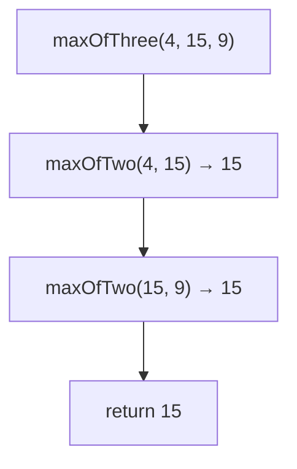
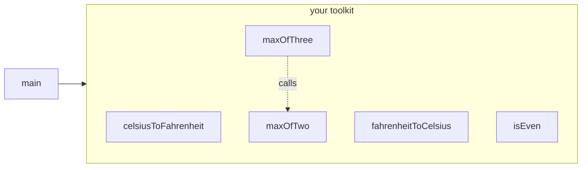
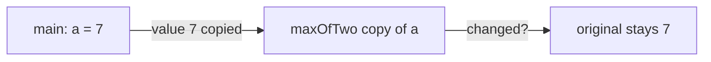

# Problem 02 — Math Toolkit

> **Session 4:** Functions
> **Concepts:** a personal library of small functions, parameters by value, and the golden rule: **write once, use it everywhere** (even inside other functions)
> **Difficulty:** Easy-Medium

---

## 1. The Problem

Build a small **toolkit** of functions and demonstrate each one in `main`:

1. `float celsiusToFahrenheit(float c)` — reuse your Session 1 converter:
   `f = c * 9.0 / 5.0 + 32`.
2. `float fahrenheitToCelsius(float f)` — the inverse.
3. `int maxOfTwo(int a, int b)`.
4. `int maxOfThree(int a, int b, int c)` — and here is the rule for this
   whole session: **do not solve it from scratch. Reuse `maxOfTwo`!**
5. `int isEven(int n)` — returns `1` if even, `0` if odd.

`main` asks the user for values and prints what each function produces.

---

## 2. Example Run

```
Enter a temperature in Celsius: 25
25.00 C = 77.00 F
Enter a temperature in Fahrenheit: 98
98.00 F = 36.67 C

Enter two integers: 7 12
Max of two: 12
Enter three integers: 4 15 9
Max of three: 15

Enter an integer to test: 7
7 is odd
```

---

## 3. How to Think About It

### One function, one job

Every function here does **exactly one small thing** and is named after
it. Small functions are easy to test, easy to fix, and easy to reuse.

### The killer example: `maxOfThree`

Bad solution (repeating yourself):

```c
int maxOfThree(int a, int b, int c) {
    int result = a;                 /* same logic again…  */
    if (b > result) result = b;     /* …dupe of maxOfTwo  */
    if (c > result) result = c;
    return result;
}
```

Good solution (write once, use everywhere):

```c
int maxOfThree(int a, int b, int c) {
    int biggest = maxOfTwo(a, b);   /* machine #1 does half the work */
    return maxOfTwo(biggest, c);    /* and half of the rest */
}
```

If a bug is found in `maxOfTwo` (say, for equal values), every function
that calls it is fixed **automatically**. Duplicated code must be fixed in
many places — that is how bugs sneak in.

### Parameters are copies (pass by value)

`maxOfTwo(7, 12)` receives the *values* 7 and 12 — even if they came from
`a` in `main`, the function cannot touch the original. It works with its
own private copies. (Why that matters, see Session 4 course material.)

---

## 4. Visual Explanation

### Reuse in action



### The toolkit map



### Parameters are copies



---

## 5. Solution Walkthrough

| Line | Meaning |
|---|---|
| `float celsiusToFahrenheit(float c)` | Takes a float, returns a float. |
| `c * 9.0 / 5.0 + 32` | Write `9.0`, not `9` — otherwise integer division eats the decimals. |
| `int maxOfThree(int a, int b, int c)` | Built from `maxOfTwo` — no duplicated logic. |
| `return x % 2 == 0;` | Chill: the comparison result (1 or 0) **is** the value. |
| `printf("%.2f", celsiusToFahrenheit(c));` | Call a function inside `printf` — its return value is printed. |

---

## 6. Key Takeaways

- Small, single-purpose functions combine into bigger programs like LEGO.
- **Never duplicate logic** — call the existing function instead.
- A function call can appear anywhere a value can: inside `printf`, inside
  another call, inside `if`.
- A comparison like `x % 2 == 0` produces a value (`1` / `0`) — you can
  return it directly.
- Keep your toolkit file — you will paste functions from it into the
  following problems. That is the intended workflow this session.

---

## 7. Try It Yourself

1. `int minOfTwo(int a, int b)` and a `minOfThree` that reuses it.
2. `float kelvinToCelsius(float k)` — and build `kelvinToFahrenheit` that
   reuses **two** of your existing functions (`kelvin → celsius → fahrenheit`).
3. Very small function: `int absolute(int x)` — one `if`… or a negative
   sign trick. Which one is less code?

---

> **Note:** if you did not understand anything in this problem, just paste it
> into ChatGPT or your AI tool and ask it to explain — and you will learn.
