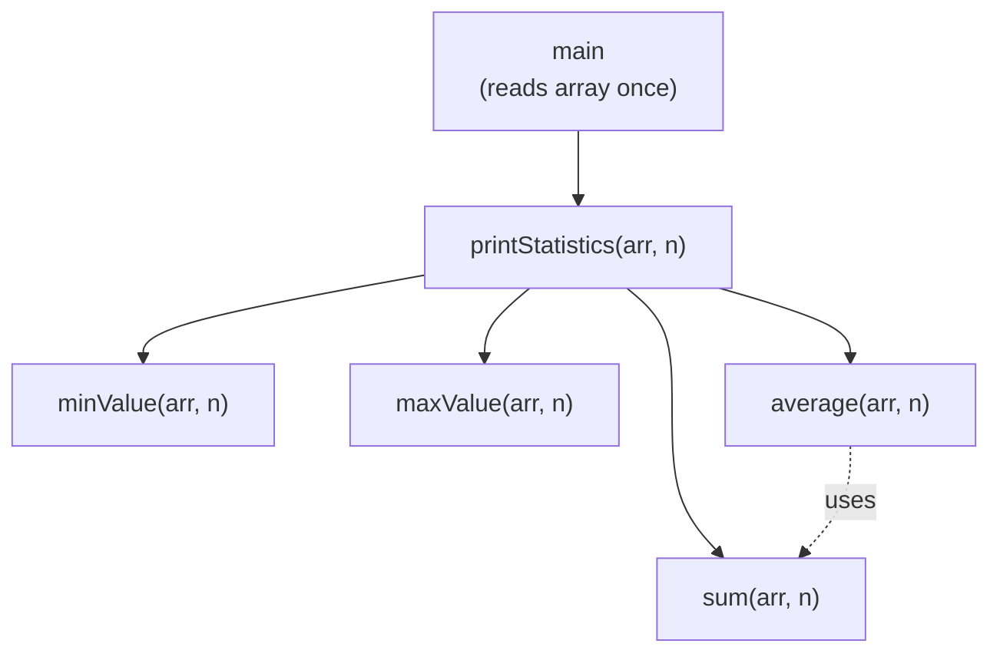
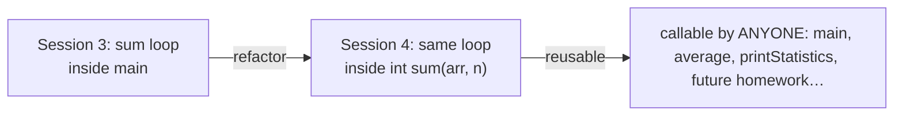
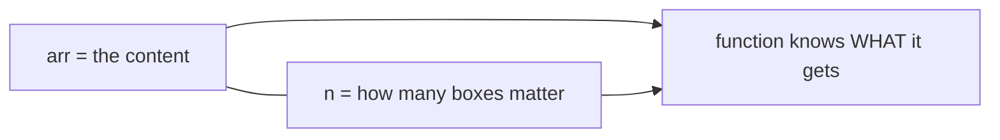

# Problem 03 — Stats as Functions

> **Session 4:** Functions
> **Concepts:** passing **arrays** to functions (`int arr[]` + length), refactoring Session 3's Problem 02, calling functions from other functions
> **Difficulty:** Medium — and the most important problem of the session

---

## 1. The Problem

You already solved array statistics in Session 3 (Problem 02) — all inside
`main`. Now **refactor**: turn every statistic into its own function:

```c
int   sum(int arr[], int n);
int   minValue(int arr[], int n);
int   maxValue(int arr[], int n);
float average(int arr[], int n);
void  printStatistics(int arr[], int n);   /* uses all of the above! */
```

`main` only: reads the array, then calls `printStatistics` once.
Do the same math you already know — the *logic* was solved last session;
today you **re-shape it into machines**.

---

## 2. Example Run

```
How many numbers? 5
Enter 5 numbers: 12 7 30 5 18

--- Statistics ---
Count:   5
Sum:     72
Average: 14.40
Minimum: 5
Maximum: 30
```

Same program as last time. Same header. The difference is invisible to the
user — but your code is now *reusable*.

---

## 3. How to Think About It

### Refactoring

**Refactoring** = keeping the program's behavior identical while
re-organizing the code. You are not solving a new problem; you are making
old work reusable. Function orientation means: *solve once, then re-shape
into a machine you can call by name forever.*

### Passing arrays — the syntax you need today

```c
int sum(int arr[], int n);        /* header */
int total = sum(numbers, n);      /* call: array name, then length */
```

| Part | Meaning |
|---|---|
| `int arr[]` in the header | "a `int` array arrives here" — treat it like a normal variable named `arr` |
| `n` | pass the **length** separately, so the function knows how many boxes to look at |
| `numbers` in the call | an array is passed by just its name — **no `&`, no `[]`** |

For now take this syntax as a rule of the language. (It is the knife-edge
of pass-by-value vs pass-by-reference — do not stress over the why yet;
your interest today is only "arrays ride into functions with their length
glued to them". Remember the pattern and it will serve you forever.)

> **Side note — `MAX_SIZE` and the user-sized array.** In `main` the array
> is **user-sized**: `int numbers[size];` after the user types the size
> (the instructor pattern from Session 3, Problem 03). `MAX_SIZE = 1000`
> is a **global variable** at the top of the file — the *ceiling* that
> validation runs against. That is the
> **global variable** idea from the slides: a local variable is created
> and destroyed inside its own function, while a global one is visible to
> **every** function and lives for the whole program run. Since the
> safety limit belongs to the whole file, giving it one shared global
> name means changing the size later = editing one line. (Write once, use
> everywhere — even for a number.)

> And one more habit to notice: the functions receive the length as their
> parameter `n` — in `main` we call `printStatistics(numbers, size)`.
> `size` (in `main`) and `n` (inside the machine) are the same value with
> two local names. Each function owns its parameter's name.

Inside the function, `arr[i]` works exactly like `numbers[i]` did inside
`main`. **Copy the loop bodies from your Session 3 solution — that is the
point: learned logic is not re-solved, it is re-used.**

### Functions calling functions

`average` does **not** need its own loop: `sum` already has one.

```c
float average(int arr[], int n) {
    return (float)sum(arr, n) / n;    /* sum ARRIVES with its loop */
}
```

And `printStatistics` (void — it prints, returns nothing) calls **all four**
of them.

---

## 4. Visual Explanation

### The call graph — small machines composed into one



### One loop body travels from main into a function



### Why every function takes `n` too



---

## 5. Solution Walkthrough

| Line | Meaning |
|---|---|
| `int sum(int arr[], int n)` | Function signature taking an array + its length. |
| `for (int i = 0; i < n; i++)` | Inside the function, loop with the *passed* length. |
| `return (float)sum(arr, n) / n;` | `average` reuses `sum` — zero new loops. |
| `void printStatistics(...)` | Void: assembles and prints, returns nothing. |
| `printf("Sum: %d\n", sum(arr, n));` | Call the function where you need the value. |

---

## 6. Key Takeaways

- **Refactoring** = same behavior, better shape. Write the program that
  works first, then reorganize it into functions.
- Arrays travel into functions as `type arr[]` **plus their length `n`**.
- A function's loop body is often *exactly* the code you once wrote in
  `main` — copy it and re-think only the boundaries.
- Functions can call functions — `average` built on `sum`; `printStatistics`
  built on everything. This layering is what real programs look like.
- **Keep this file.** Problem 04 and the Final Task will *paste* these
  functions. That is the "write once, use everywhere" workflow.

---

## 7. Try It Yourself

1. `int countEven(int arr[], int n)` — the split-loop from Session 3
   Problem 03, now returning just the count.
2. `int countAbove(int arr[], int n, float t)` — with a parameter! Same
   function answers "above 10?", "above -50?" infinitely.
3. Write a second `printStatistics2` that prints statistics **of the even
   numbers only** by composing `countEven` + the existing functions.

---

> **Note:** if you did not understand anything in this problem, just paste it
> into ChatGPT or your AI tool and ask it to explain — and you will learn.
