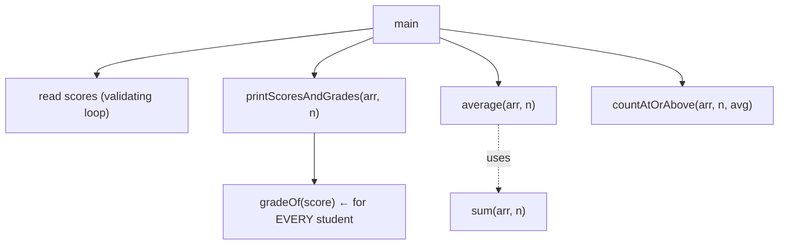
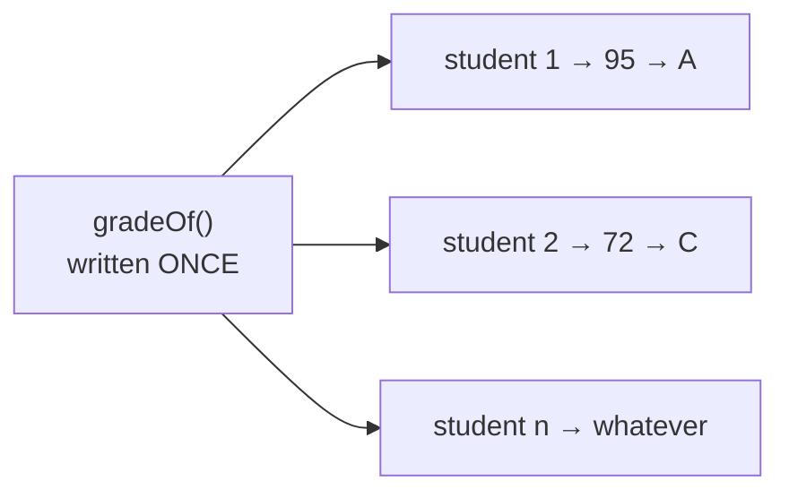
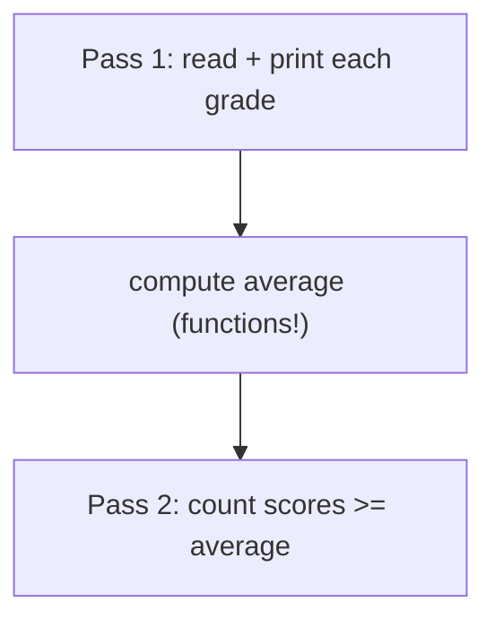

# Problem 04 — Gradebook

> **Session 4:** Functions
> **Concepts:** composing function libraries — `char` function returning a grade, reusing `sum`/`average` from Problem 03, one function serving a whole loop
> **Difficulty:** Medium-Hard — and your first taste of the "write once, use everywhere" payoff

---

## 1. The Problem

Build a mini gradebook:

1. Read `n` exam scores (`0 … 100`, validate each one) into an array.
2. Print every score with its **letter grade**.
3. Print the **class average** and how many students are at or above it.

The rules of grading (reuse your Session 2 logic — you *have* written this
chain before!):

| Score | Grade |
|---|---|
| 90 – 100 | `A` |
| 80 – 89 | `B` |
| 70 – 79 | `C` |
| 60 – 69 | `D` |
| 0 – 59 | `F` |

---

## 2. Example Run

```
How many students? 4
Enter score for student 1 (0-100): 95
Enter score for student 2 (0-100): 72
Enter score for student 3 (0-100): 88
Enter score for student 4 (0-100): 150
Invalid score, try again (0-100): 50

--- Gradebook ---
Student 1: 95 → A
Student 2: 72 → C
Student 3: 88 → B
Student 4: 50 → F

Class average: 76.25
At or above average: 2 student(s)
```

---

## 3. How to Think About It

### The reused museum

You now own three machines from previous problems. This problem is:
*paste them in, and compose the new logic around them.*

| Function you already wrote | Where it comes from | Used here for |
|---|---|---|
| `int sum(int arr[], int n)` | Problem 03 (itself from S3 P02) | class total |
| `float average(int arr[], int n)` | Problem 03 (built on `sum`) | class average |
| the grading `if/else` chain | Session 2 grade classifier | new function `gradeOf` |

### The one new function

```c
char gradeOf(int score)
{
    if (score >= 90) return 'A';
    else if (score >= 80) return 'B';
    ...
    else return 'F';
}
```

Notice differently from previous functions: it takes **one** `int` and
returns a `char` — a single letter. No arrays at all. It is the *smallest*
possible machine, and precisely because of that, it can serve any number
of students: **one definition, called once per student inside the loop**.

That is the whole "write once, use everywhere" lesson in miniature: the
grading rules exist exactly once in the universe of your code. Change the
rule for `B` to `75`, and all 10,000 students get re-graded by changing
**one line**.

### Re-counting above average

The average is only known *after* the loop. So the above-average check is
a **second loop** — read: first machine collects data, second machine
uses the collection. Loops over the same array for different jobs is
completely normal (you did it in Session 3 already).

---

## 4. Visual Explanation

### The call graph



### One grading brain, many callers



### Two-pass shape of main



---

## 5. Solution Walkthrough

| Line | Meaning |
|---|---|
| `char gradeOf(int score)` | Returns a single character — `char` type. |
| `return 'A';` | Character literals in single quotes `'A'`. |
| `int MAX_SIZE = 1000;` (top of file) | **Global variable**: lives outside every function, visible to all of them, alive the whole run. |
| `for (int i = 0; i < n; i++)` … `gradeOf(scores[i])` | One brain, every student |
| `float avg = average(scores, n);` | Problem 03's function, pasted unchanged |
| `if (scores[i] >= avg) above++;` | Pass 2, after the average is known |
| `do { scanf … } while (invalid);` | Input validation loop (Session 2 `do-while`) |

---

## 6. Key Takeaways

- Growing a program = adding new **small** functions and wiring old ones.
- `char` is a return type like any other; `'A'` has single quotes.
- Very small, very focused functions (`gradeOf`) are the most reusable.
- Copying a function you wrote in an earlier problem into a new program is
  **good practice** — that is the function mindset. (Later in your journey,
  files and libraries will automate this; the reflex starts today.)
- Two loops over the same array are fine when the second loop needs the
  first loop's results.

---

## 7. Try It Yourself

1. Add `int bestStudent(int arr[], int n)` that *returns the index* of the
   highest score (Session 3 min/max logic, flipped to return position).
2. Print a tiny histogram: for each grade A–F, a row of `*` matching the
   count (`A: **`). Categorize with `gradeOf`, count with the
   counter-index pattern from Session 3.
3. Make `gradeOf` accept nothing below 0 or above 100 — how do you return
   "no grade" for bad input? (Hint: what could `char` return? Try `'?'`.)

---

> **Note:** if you did not understand anything in this problem, just paste it
> into ChatGPT or your AI tool and ask it to explain — and you will learn.
