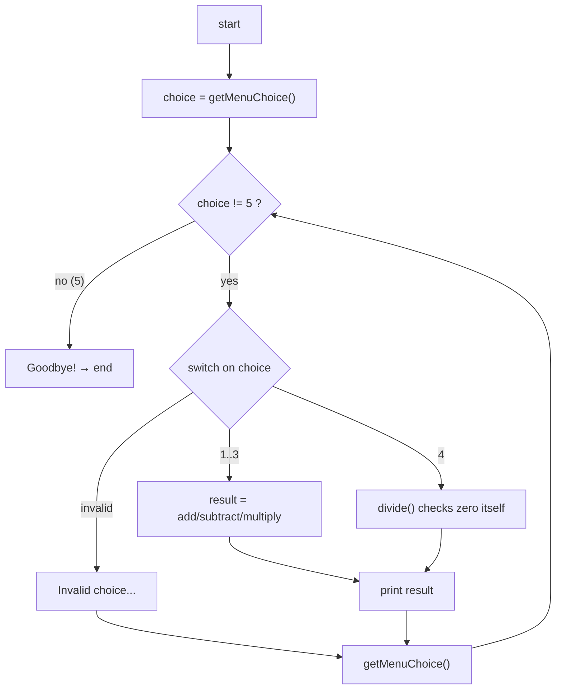
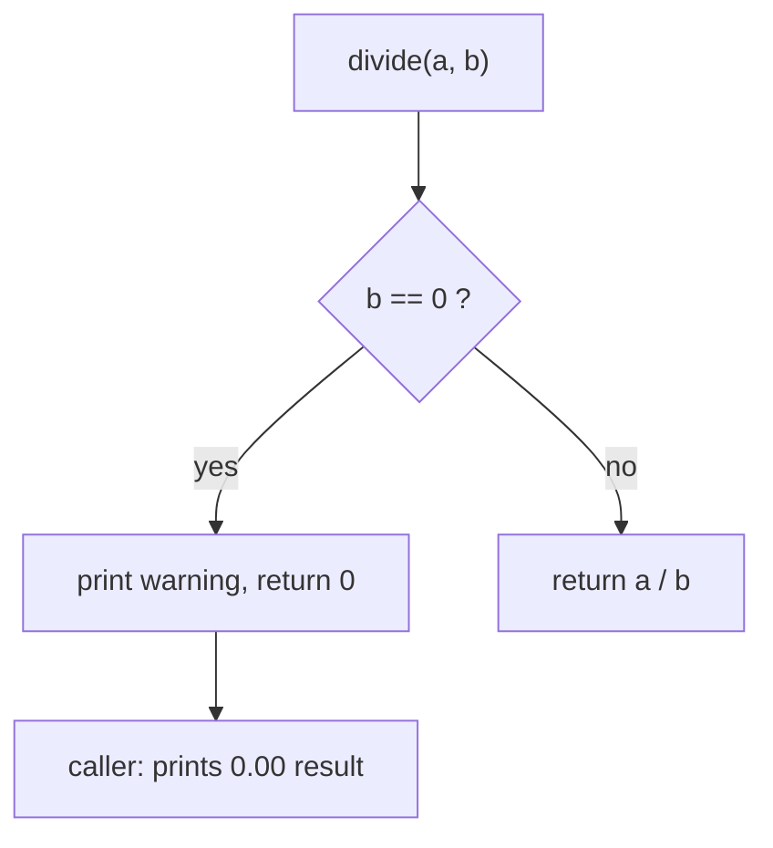
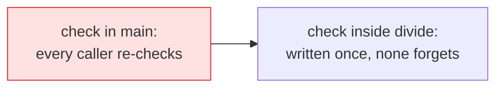

# Problem 05 — Menu Calculator

> **Session 4:** Functions
> **Concepts:** the full combo — menu loop + `switch` + typed functions + composing everything from Sessions 1–4
> **Difficulty:** Level-Up

---

## 1. The Problem

Build a calculator that stays open until the user quits — like a food menu
in a restaurant ordering app:

```
==== Menu Calculator ====
1. Add
2. Subtract
3. Multiply
4. Divide
5. Exit
Choose (1-5): _
```

- **If the user picks 5** → print goodbye and end the program.
- Otherwise read two numbers, call the right math function, and print the
  result rounded to 2 decimals.
- Division by **zero** must stay safe: print a warning instead of crashing.
- Keep asking until the user quits.

Structure it with functions:

| Function | Type | Job |
|---|---|---|
| `getMenuChoice()` | `int` | prints the menu, reads + returns the choice |
| `add(a, b)`, `subtract(a, b)`, `multiply(a, b)` | `float` | the math machines |
| `divide(a, b)` | `float` | guards zero itself |

---

## 2. Example Run

```
==== Menu Calculator ====
1. Add
2. Subtract
3. Multiply
4. Divide
5. Exit
Choose (1-5): 1
Enter two numbers: 7 3
7.00 + 3.00 = 10.00

==== Menu Calculator ====
Choose (1-5): 4
Enter two numbers: 9 0
Cannot divide by zero.

==== Menu Calculator ====
Choose (1-5): 5
Goodbye!
```

---

## 3. How to Think About It

This single problem reuses a technique from **every** previous session:

| Skill | From where | Used here |
|---|---|---|
| arithmetic + `printf` | Session 1 | the math machines |
| menu + validation `while`/`do-while` | Session 2 (calculator menu) | `getMenuChoice` |
| `switch` statement | Session 2 | dispatching to the right machine |
| `break` in loops vs `break` in `switch` | Session 2, 3 | carefully — two meanings live here! |
| arrays? — **no**, this one is pure functions | — | proof that functions can stand alone; arrays join back in the Final Task |
| typed vs void functions | Session 4 P01–03 | everything above |

### The control flow

```c
while (choice != 5) {
    switch (choice) {
        case 1: printf(... add ...); break;   /* break = leave SWITCH */
        ...
    }
    choice = getMenuChoice();                  /* ask again AFTER the work */
}
```

### The two `break`s — know exactly which one you mean

```c
switch (choice) {
    case 1:
        result = add(a, b);   /* statement...          */
        break;                /* ...then LEAVE SWITCH  */
}
```

A `break` inside a `switch` that sits inside a `while` only exits the
**switch**. The loop continues. If you think it exits the loop you will
write "one-shot menus" — a classic bug. (And `case 4:)` guard the zero
*before* calling `divide`? No — look at the solution: the guard lives
**inside** `divide` and is honest about it (prints the warning, `return`s
0). Encapsulation: every future caller of `divide` gets the protection for
free, without even knowing it exists.

### The quiet star: `getMenuChoice`

Every menu problem from Session 2 forward prints ~7 lines and scans a
number. Writing that **once** as a function — and simply calling it after
each operation — means adding new menu options later costs nothing. Watch
how the solution's `while` loop has *no menu printing at all*: it was
absorbed into the machine.

---

## 4. Visual Explanation

### The program's life



### Guarding division zero — inside the machine



### Why the zero check lives in `divide`



---

## 5. Solution Walkthrough

| Line | Meaning |
|---|---|
| `int getMenuChoice(void)` | Empty parameter list: asks nothing, gives the choice. |
| `while (choice != 5)` | Keep serving until Exit. |
| `case 1: ... break;` | `break` = leave the switch, NOT the loop. |
| `default:` | Every switch should be ready for nonsense input. |
| `choice = getMenuChoice();` | Refreshed both at start and after each operation. |
| `float divide(float a, float b)` | The zero-guard is part of the machine. |

---

## 6. Key Takeaways

- A menu program = **loop + switch + small typed functions**. You can now
  build any console menu of reasonable size.
- `break` inside `switch` exits only the `switch`.
- Put safety checks **inside the machine** that needs them — one place,
  used everywhere, never forgotten. (Write once, use everywhere applies to
  *logic safety*, too.)
- A function such as `getMenuChoice` can encapsulate *reading input* —
  its I/O kid gloves come pre-worn anywhere you call it.
- This is the final solo-problem pattern of the course: from here on,
  problems combine — like the Final Task.

---

## 7. Try It Yourself

1. Add options `6. Modulus (%)` and `7. Power of two` — can you reuse
   machines like the `square` idea from Problem 01? Yes, you can.
2. Track a **memory**: `store` the last result in a `static` variable
   (or a global — Session 4 course covers scope!) and offer "use memory in
   next operation".
3. Rewrite the menu itself using an array of strings as a stretch goal —
   and notice how much code disappears (you will need the strings document
   in the `learning/` folder for this one).

---

> **Note:** if you did not understand anything in this problem, just paste it
> into ChatGPT or your AI tool and ask it to explain — and you will learn.
